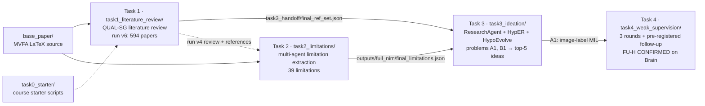

# Intro to LLMs: course project on MVFA-AD

Base paper: **MVFA**, *Adapting Visual-Language Models for Generalizable Anomaly Detection in Medical Images* (CVPR 2024, [arXiv:2403.12570](https://arxiv.org/abs/2403.12570), [code](https://github.com/MediaBrain-SJTU/MVFA-AD)).

The project is a four-stage pipeline. Each stage's output is copied forward as the next stage's input:



Solid arrows are file handoffs that `make sync` copies and `make check` verifies byte-for-byte; [PIPELINE.md](PIPELINE.md) lists every file. The dotted Task 1 → Task 2 arrow is an older handoff: Task 2 was built on Task 1 **run v4**, while Task 3 uses **run v6**. See [PIPELINE.md](PIPELINE.md#known-mismatch-task-2-used-task-1-run-v4) for details.

## Quick start

```bash
make help        # every command
make venv        # .venv-pipeline: Python 3.12+ with requirements-smoke.txt (Tasks 0-3)
make smoke       # every stage's offline dry run, then `make check` (~5 s, no API call, no GPU)
make test        # Task 4's CPU test suites (27 + 41 + 80 + 59 tests, 2-4 min)
```

Nothing in `smoke`, `check`, `test`, `sync-dry-run` or `taskN-dry-run` calls a paid API, uses a GPU or changes a tracked file. `smoke` checks that last point itself.

## Layout

| Folder | What it is | Details |
|---|---|---|
| `base_paper/` | MVFA's arXiv LaTeX source (`main.tex`, `sec/`, `img/`, `main.bbl`) | Read by Task 0's `extract_related.py` and Task 2 |
| `task0_starter/` | The course's starter scripts and their outputs: `scholar_scraper.py` → `llm_healthcare_papers.csv` → `rank_papers.py` → `ranked_papers.csv` → `generate_prompt.py` → `llm_prompt.txt` → `generate_review.py`; `extract_related.py`; `lit_review.md`, `final_report.md` | Before the restructure these sat in the repo root. `base_paper` here is a symlink to `../base_paper` |
| `task1_literature_review/` | **Task 1**: QUAL-SG (SurveyGen reimplementation), `qual_sg/` package, `runs/v5…`, `runs/v6…`, `task3_handoff/` | [README](task1_literature_review/README.md) |
| `task2_limitations/` | **Task 2**: multi-agent limitation pipeline (`run_pipeline.py`, `agents.py`, `retrieval.py`, `evaluate.py`), `data/`, `outputs/`, and `deliverables/` (formerly the root `DELIVERABLES/`) | [README](task2_limitations/README.md), [deliverables/task2/TASK2_DOCUMENTATION.md](task2_limitations/deliverables/task2/TASK2_DOCUMENTATION.md) |
| `task3_ideation/` | **Task 3**: stages 0–4 (`stage*.py`, `run_all.py`), `logs/cache/` (every prompt and answer), `outputs/`, `reports/*.pdf`, `explorer/` | [README](task3_ideation/README.md) |
| `task4_weak_supervision/` | **Task 4**: `round1/`, `round2/`, `round3/`, `followup/`, `plans/`, `download_data.sh` | [round1](task4_weak_supervision/round1/README.md), [round2](task4_weak_supervision/round2/README.md), [round3](task4_weak_supervision/round3/README.md), [followup](task4_weak_supervision/followup/README.md) |
| `pipeline/` | `sync_handoffs.py` + `handoffs_manifest.json`, `check_repo.py`, `smoke.py` | [PIPELINE.md](PIPELINE.md) |
| `shared/` | `config.sh` / `config.py`: paths and keys from the environment, then `.env`, then defaults | [Configuration](#configuration) |

Inside `task4_weak_supervision/`, the symlinks `task4 → round1`, `task4r2 → round2`, `task4r3 → round3`, `task4fu → followup` and `Plans → plans` are deliberate:
- The rounds import each other by their old sibling names (e.g. `R2.parent / "task4"`).
- The frozen analysers read `R1.parent / "task4r2"` (`analyze3.py`) and `FU.parent / "task4r3"` (`analyze_fu.py`).
- Those files are hash-locked in `report/FROZEN.sha256` and must not be edited.

The symlinks also keep valid the paths that the Task 4 reports quote, such as `task4r3/…`.

### Where things moved (old path → new path)

Older documents inside the task folders still use the old names. Moving files was allowed; editing reports and logs was not.

| Before | Now |
|---|---|
| `literature_review/` | `task1_literature_review/` |
| `limitations/` | `task2_limitations/` |
| `DELIVERABLES/` (README + `task2/`) | `task2_limitations/deliverables/` |
| `task3/` | `task3_ideation/` |
| `task4/`, `task4r2/`, `task4r3/`, `task4fu/` | `task4_weak_supervision/round1/`, `round2/`, `round3/`, `followup/` (old names kept as symlinks there) |
| `Plans/`, `TASK4_PLAN_RECOMMENDED.md` | `task4_weak_supervision/plans/` |
| `download_task4.sh` | `task4_weak_supervision/download_data.sh` |
| `scholar_scraper.py`, `rank_papers.py`, `generate_prompt.py`, `generate_review.py`, `extract_related.py`, `*.csv`, `llm_prompt.txt`, `ranked_output.txt`, `lit_review.md`, `final_report.md`, `base_paper_related_titles.txt` | `task0_starter/` |

On the server, Task 4's rounds were run from `proj/task4*` (outside this repo), so their logs and reports name those paths.

## Running each stage

| Stage | Offline dry run | Real run | Needs |
|---|---|---|---|
| Task 0 starter | `make task0-dry-run`: re-runs `generate_prompt.py` and `extract_related.py` in a scratch copy and checks both outputs are identical to the committed ones | `make task0` | arXiv (network); `sentence-transformers` + model download; `AGENTROUTER_API_KEY` for `generate_review.py` |
| Task 1 QUAL-SG | `make task1-dry-run`: compiles 48 files, imports all 31 `qual_sg` modules, loads the stage list, validates the hand-off (594 papers × 12 non-empty fields) | `make task1` (= `bash runs/v6_2026-11-16/run_env.sh`) | `OPENALEX_API_KEY`; an LLM (`QUAL_SG_BACKEND=file` answers prompts by hand as in v6, or `openai` + `GROQ_API_KEY`). HTTP/LLM caches are not committed, so a run starts from retrieval |
| Task 2 limitations | `make task2-dry-run`: compiles and imports every module, `run_pipeline.py --help`, validates 39 limitations and the 223-paper corpus | `make task2` (`LLM_PROVIDER=nim`); then `evaluate.py` as in its README | `NVIDIA_API_KEY` (main run, MiniMax via NIM) or `AGENTROUTER_API_KEY`; network for `build_corpus.py`. Its LLM `cache/` was never committed, so nothing can be replayed |
| Task 3 ideation | `make task3-dry-run`: deletes the 12 files `run_all.py` writes in a scratch copy, replays stages 0–4 + explorer from `logs/cache/` with the file backend, checks all 18 output files are byte-identical and that no new cache entries or pending prompts appeared | `make task3` replays the cache in place; `LLM_BACKEND=openai LLM_API_KEY=… make task3` calls a model for anything not cached | Nothing to replay. A model API for new prompts; xelatex for `make_reports.py`; Gemini API for `rejudge.py`; a GPU for `colab/` |
| Task 4 weak supervision | `make task4-dry-run`: frozen hashes; re-runs frozen `analyze3.py` / `analyze_fu.py` on the committed `results.csv` and checks the analyses are byte-identical; parses every shell script; lists the round-3 (58) and follow-up (10) GPU queues without starting them. `make test`: 207 CPU tests. `make task4-smoke-cpu`: round 3's tiny CPU training run | `CONFIRM_GPU=1 make task4` (the follow-up's `go.sh`); rounds 1–3: `task4_weak_supervision/roundN/run_all.sh` | GPUs (2 on the server); BMAD data, MVFA zero-shot checkpoints and CLIP ViT-L/14-336 at `$TASK4_HDD` (`download_data.sh`); the MVFA-AD checkout at `$MVFA_DIR`; `$TASK4_PYTHON` with `task4_weak_supervision/requirements.txt` |
| everything | `make smoke` | `make all` (sync, then task1 → task4; stops at the first stage that lacks a key) | all of the above |

`make task4` and `make all` refuse to start GPU jobs unless `CONFIRM_GPU=1` is set. The GPUs are shared.

### Expected outputs

| Stage | Main output |
|---|---|
| Task 0 | `task0_starter/ranked_papers.csv`, `llm_prompt.txt`, `base_paper_related_titles.txt` (empty in the committed version, and re-created empty), `lit_review.md` |
| Task 1 | `runs/v6_2026-11-16/final_ref_set.json` (594 candidate papers, 59 of them cited in the review) → `task3_handoff/`; the 2-page review from run v5 |
| Task 2 | `outputs/full_nim/final_limitations.json` (39 limitations), `outputs/full_nim/research_gaps.md`; `deliverables/task2/task2_research_gaps.md`; `outputs/evaluation.md` |
| Task 3 | `outputs/stage4_ranking_{A1,B1}.json` (top 5 per problem), `reports/Task3_Submission.pdf`, `explorer/mvfa_idea_explorer.html` |
| Task 4 | per round, `results/results.csv` + `results/analysis.md` and `report/*.md`. Follow-up: `followup/results/analysis_fu.md` (FU-H CONFIRMED: MIL+10 % beats MVFA on Brain AUPRO on 5/5 seeds, p = 0.031) |

## Configuration

Every setting is resolved in the same order: **the environment, then `.env`, then defaults in `shared/config.sh` / `shared/config.py`**. Copy `.env.example` to `.env` (git-ignored) and fill in only what you need. `make config` shows the paths in effect and which keys are set, without printing the keys.

| Variable | Default (resolves to the server's original path) | Used by |
|---|---|---|
| `PROJ_ROOT` | the folder that holds this repo (`proj/`) | the defaults below |
| `MVFA_DIR` | `$PROJ_ROOT/MVFA-AD` | Task 4 round 1 `common.py` (all rounds import it) |
| `TASK4_PYTHON` | `$PROJ_ROOT/.venv-task4/bin/python` | every Task 4 shell script, `make test` |
| `TASK4_HDD`, `TASK4R2_HDD`, `TASK4R3_HDD` | `/mnt/HDD1/divyam/task4`, `…/r2`, `…/r3` (`…/fu` in `followup/`) | Task 4 data, checkpoints and runs. These env-var defaults were already in the code; the tests check their exact text, so they stay as they are |
| `PYTHON` | `.venv-pipeline/bin/python` if present, else `python3` | Tasks 0–3 in the Makefile and `pipeline/smoke.py` |
| API keys | none | see `.env.example`: `AGENTROUTER_API_KEY` (Task 0, Task 2), `OPENALEX_API_KEY` / `GROQ_API_KEY` (Task 1), `NVIDIA_API_KEY` (Task 2), `LLM_*` / `JUDGE_*` (Task 3) |

Requirements: [`requirements.txt`](requirements.txt) for Tasks 0–3 (it includes each task's own file), [`requirements-smoke.txt`](requirements-smoke.txt) for the offline checks, and [`task4_weak_supervision/requirements.txt`](task4_weak_supervision/requirements.txt), pinned to the server's environment.

Notes:
- **Python version:** Task 3's code uses f-strings that need **Python 3.12 or newer**. `task3_ideation/README.md` says 3.10, but its stages fail with a `SyntaxError` there. Tasks 0–2 run on 3.10–3.14.
- **Never commit** datasets, weights (`*.pth`, …) or `.env`. `make check` fails if a weights file or any file over 20 MB is tracked.

## Checks

- `make check` runs:
  - `pipeline/sync_handoffs.py --check`: every handoff copy is byte-identical to its source and to the hashes in `pipeline/handoffs_manifest.json`.
  - `pipeline/check_repo.py`:
    - Task 4's frozen files match `round3/report/FROZEN.sha256` and `followup/report/FROZEN.sha256`;
    - the compatibility symlinks resolve;
    - no weights or large files are tracked;
    - no server paths are hard-coded outside the config defaults;
    - the git user's e-mail address appears in no tracked file.
- `make test` runs the Task 4 suites on CPU: round 1 27, round 2 41, round 3 80 and the follow-up 59 tests.
