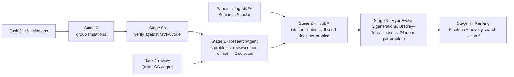

# Task 3 — Research Problem Discovery and Ideation for MVFA

Task 3 of the *Introduction to Large Language Models* course project. Starting from the limitations of our base paper, **MVFA**, which we identified in Task 2, this pipeline:

1. formulates **two fine-grained research problems** (with **ResearchAgent**);
2. generates **literature-grounded research ideas** for each problem (with **HypER**);
3. **evolves** the ideas with a genetic algorithm (with **HypoEvolve**);
4. **ranks** them on Novelty, Feasibility, Clarity, Impact and Validity, and selects the **top 5 per problem**.

Our base paper is MVFA: *Adapting Visual-Language Models for Generalizable Anomaly Detection in Medical Images*, CVPR 2024 ([paper](https://arxiv.org/abs/2403.12570), [code](https://github.com/MediaBrain-SJTU/MVFA-AD)).

| Deliverable | Where |
|---|---|
| Submission document (problems, ranking tables, top-5 ideas in full) | [`reports/Task3_Submission.pdf`](reports/Task3_Submission.pdf) |
| Full documentation (every stage, every decision, limitations, future work) | [`reports/Task3_Documentation.pdf`](reports/Task3_Documentation.pdf) |
| Interactive explorer of all intermediate results | [`explorer/mvfa_idea_explorer.html`](explorer/mvfa_idea_explorer.html). Download it and open it in a browser. |
| Every prompt and every model answer | `logs/cache/` (1,100 records) and `logs/calls.jsonl` |

---

## Results

### Problem 1 (A1): mask-free localisation for MVFA's segmentation adapters

> How much of MVFA's zero-shot localisation quality (pixel AUROC and Dice on a held-out modality) is retained when its segmentation adapters are trained **without pixel masks**? The masks are replaced by pseudo-masks drawn only from source images labelled abnormal.

Stage 1 score: 4.0 → 4.2 → 4.4 over the three refinement rounds.

| # | ID | Idea | Review mean (1–5) | Final score |
|---|---|---|---|---|
| 1 | A1-g1-o6 | **Detection-branch veto:** MVFA's detection maps, trained on image-level labels, filter the pseudo-masks for the segmentation branch | 4.0 | 0.825 |
| 2 | A1-g3-o3 | **Detection-gated mean teacher:** online pseudo-mask refinement, accepted only where the detection branch agrees | 3.8 | 0.744 |
| 3 | A1-g2-o6 | **Occlusion attribution** of MVFA's detection branch as pseudo-masks | 3.8 | 0.708 |
| 4 | A1-g3-o1 | **Cross-level persistence:** keep anomalies that persist across MVFA's four feature levels | 3.8 | 0.676 |
| 5 | A1-g2-o4 | **Mean-teacher** online refinement of pseudo-masks | 3.4 | 0.577 |

### Problem 2 (B1): inductive per-image scoring for few-shot MVFA

> Can MVFA's few-shot inference score **each image on its own**? Instead of the test-set min-max normalisation found in the released code, it would use statistics of the K support images and source-validation data only. The score should keep image AUROC within 1 point and stay invariant to the rest of the test set.

Stage 1 score: 4.2 in all three rounds.

| # | ID | Idea | Review mean (1–5) | Final score |
|---|---|---|---|---|
| 1 | B1-g3-o5 | **Cauchy-combined level-wise conformal p-values**, fused in log-odds with a temperature-calibrated zero-shot branch | 4.0 | 0.825 |
| 2 | B1-g1-o2 | **Conformal few-shot p-values** combined with temperature-calibrated zero-shot probabilities | 4.0 | 0.776 |
| 3 | B1-g0-C5 | **Log-odds fusion** of temperature-calibrated branches | 4.0 | 0.706 |
| 4 | B1-g1-o3 | **Support-CDF scores** with source-episode isotonic calibration | 3.6 | 0.547 |
| 5 | B1-g3-o4 | **Online false-discovery-rate control** over a stream of scored images | 4.0 | 0.525 |

How the scores are computed:
- **Final score** = 0.7 × normalised review mean + 0.3 × normalised evolutionary fitness.
- At most two ideas from the same method family can enter a top 5.
- Each idea in the submission PDF comes with:
  - a hypothesis with the result that would falsify it;
  - a step-by-step method that names the MVFA files to change;
  - an experiment design;
  - the reviews and the closest prior work;
  - its lineage.

---

## Pipeline



| Stage | Script | What it does | Output |
|---|---|---|---|
| 0 | `stage0_gaps.py` | Parses the 15 Task 2 limitations and groups them | `outputs/stage0_gaps.json` |
| 0b | `stage0b_verify.py` | Checks every implementation claim against MVFA's code, with file:line evidence (no LLM) | `outputs/stage0b_code_verification.json`, `outputs/gaps_verified.json` |
| 1 | `stage1_problems.py` | ResearchAgent: problem generation, five-criterion reviews with human-induced rubrics, two refinement rounds | `outputs/stage1_problems.json` |
| 2 | `stage2_hyper.py` | HypER: relevance-scored citation chains and one seed idea per chain, with provenance | `outputs/stage2_chains.json`, `outputs/stage2_seeds.json` |
| 3 | `stage3_evolve.py` | HypoEvolve: crossover and mutation by LLM, pairwise judging, Bradley–Terry fitness, (μ+λ) selection | `outputs/stage3_evolution_{A1,B1}.json` |
| 4 | `stage4_rank.py` | Reviews on five criteria, method families, diversity rule, final top 5 | `outputs/stage4_ranking_{A1,B1}.json` |

**Code verification found discrepancies between the paper and the released code.** The confirmed issues are:
- checkpoints are selected on the target test set;
- the loss uses mean pooling, while the paper says max pooling;
- scores are normalised with the test set's min and max;
- the learning rate and batch size differ from the paper.

These findings shaped both problems. They are listed with links to the exact lines in the documentation (section 4.2).

---

## Quick start

Python 3.10 or newer.

```bash
cd task3
pip install -r requirements.txt
python3 run_all.py
```

`run_all.py` replays the whole run from `logs/cache`. It needs no API key and makes no new model calls, so every number in the reports can be regenerated.

To rebuild the explorer and the PDFs:

```bash
python3 export_explorer_data.py   # outputs/explorer_data.json + explorer/mvfa_idea_explorer.html
python3 make_reports.py           # reports/*.pdf (needs xelatex with TeX Gyre Pagella/Heros and DejaVu Sans Mono fonts)
```

### Running with a real API model

All model calls go through `llm_client.py`. Each call has a role, either `generator` or `judge`, and is cached by a hash of (model, prompt, sample index).

```bash
# any OpenAI-compatible endpoint (Groq, AgentRouter, OpenAI, ...)
export LLM_BACKEND=openai
export LLM_BASE_URL=https://api.groq.com/openai/v1
export LLM_API_KEY=...            # never commit keys; they are read from the environment only
export LLM_MODEL=llama-3.3-70b-versatile
python3 run_all.py
```

`JUDGE_BACKEND`, `JUDGE_BASE_URL`, `JUDGE_API_KEY` and `JUDGE_MODEL` override the `LLM_*` settings for judge calls only.

### Independent re-judging

The same model generated and judged the ideas in this run, as in ResearchAgent and HypoEvolve. `rejudge.py` sends exactly the same judge prompts to a different model and measures how far the two judges agree:

```bash
export JUDGE_BACKEND=openai JUDGE_BASE_URL=https://api.groq.com/openai/v1 JUDGE_API_KEY=... JUDGE_MODEL=llama-3.3-70b-versatile
python3 rejudge.py                 # 464 judge calls; or a 114-call subset: python3 rejudge.py stage1 stage4
```

It writes `outputs/rejudge_<model>.json` with the following measures:
- Stage 1 reviews: Spearman correlation and exact agreement.
- Stage 2 relevance: weighted kappa.
- Stage 3 comparisons: winner agreement and a Bradley–Terry refit.
- Stage 4: Spearman correlation per criterion and the top 5 recomputed from the new reviews.

### How this run was produced

This run used the **file backend**:
1. Each missing answer was written to `logs/pending/`.
2. The configured model (Claude, `claude-opus-5-5`) answered it as generator or judge.
3. The answers were ingested with `python3 llm_client.py ingest`.

The run made **521 new model calls** and reused **15** from an earlier run. The scripts that wrote the answers are kept in `logs/answers/run2_qualsg/` for auditability.

---

## Settings you can change

| File | Setting | Default | Meaning |
|---|---|---|---|
| `stage3_evolve.py` | `BOTH_ORDERS` | `False` | `True` judges each pair in both orders to correct position bias (about 1.8× the calls) |
| `stage3_evolve.py` | `MU`, `LAMBDA`, `G`, `PC`, `PM` | 6, 6, 3, 0.6, 0.15 | HypoEvolve population size, offspring per generation, generations, crossover and mutation probabilities |
| `stage4_rank.py` | `SHORTLIST`, `TOP_K`, `MAX_PER_FAMILY` | 12, 5, 2 | Ranking pool, ideas selected, diversity limit |
| `stage4_rank.py` | `W_REVIEW`, `W_FIT` | 0.7, 0.3 | Weights of the review mean and the fitness in the final score |
| `stage2_hyper.py` | `BRANCHES`, `HOP2_PREFILTER` | 6, 20 | Number of citation chains; second-hop candidates per chain |
| `stage1_problems.py` | `GROUPS`, `N_REFINE` | A, B, D; 2 | Limitation groups used for problems; refinement rounds |

---

## Repository layout

```
task3/
├── run_all.py               # runs every stage in order (replays from cache by default)
├── llm_client.py            # file / OpenAI-compatible backends, roles, cache
├── answer.py                # helper for answering pending prompts (file backend)
├── corpus.py                # Task 1 corpus loader, review set, keyphrase entity store (ResearchAgent Eq. 2)
├── stage0_gaps.py … stage4_rank.py
├── rejudge.py               # independent re-judging with another model
├── agreement.py             # human–model agreement from exported explorer ratings
├── fetch_citations.py       # Semantic Scholar forward citations (run locally; standard library only)
├── novelty_search.py        # re-runs the Stage 4 novelty queries on Semantic Scholar
├── export_explorer_data.py  # builds outputs/explorer_data.json and the explorer page
├── make_reports.py          # builds both PDFs from the outputs
├── prompts/                 # all prompt templates; ResearchAgent rubrics verbatim; HypER relevance prompt from its released code
├── data/
│   ├── paper_after_reranking.csv   # final Task 1 corpus (QUAL-SG, 259 papers)
│   ├── pipeline_ref.json           # Task 1 review set (60 papers)
│   ├── s2_citations.json           # papers citing MVFA (Semantic Scholar)
│   ├── novelty_search.json         # novelty evidence for the shortlisted ideas
│   ├── mvfa_code/                  # snapshot of MVFA's public code (MIT licence) used for code verification
│   └── unused/                     # superseded Task 1 files, kept for reference
├── outputs/                 # results of every stage (JSON)
├── reports/                 # Task3_Submission.pdf, Task3_Documentation.pdf
├── explorer/                # interactive explorer (template + built page)
├── logs/                    # calls.jsonl, cache/ (every prompt and answer), answers/
└── runs/run1_surveygen341/  # first, archived run on an earlier version of the Task 1 corpus
```

---

## Methods and how faithfully they are implemented

- **ResearchAgent** ([arXiv:2404.07738](https://arxiv.org/abs/2404.07738)). Faithful parts:
  - the problem-identification prompt and the ReviewingAgent prompts, with one call per criterion;
  - the human-induced rubrics, copied verbatim;
  - entity retrieval by Eq. 2;
  - iterative refinement.

  Adaptations:
  - the limitation group is an extra input;
  - entities are key phrases taken from the abstracts, instead of BLINK entity linking.
- **HypER** ([arXiv:2506.12937](https://arxiv.org/abs/2506.12937)). Faithful parts:
  - the released relevance prompt (0/1/2) with the authors' few-shot examples;
  - the 2-year citation window;
  - candidate scoring 0.7·relevance + 0.3·citations;
  - the generation prompt with provenance.

  Adaptation: with a single source paper, the six best first-hop papers each start a chain. The distilled small model was not trained; this is documented as future work.
- **HypoEvolve** ([arXiv:2609.15938](https://arxiv.org/abs/2609.15938)). Implemented as Algorithm 1 with the paper's settings:
  - μ = λ = 6, three generations;
  - combination and inspiration crossover;
  - substitution and out-of-box mutation;
  - all-pairs judging with Bradley–Terry fitness.

## Limitations

- The same model generated and judged the ideas. Mitigations:
  - code verification and a literature novelty search as non-LLM evidence;
  - `rejudge.py` for an independent judge;
  - a rating form in the explorer to measure human–model agreement.
- Pairwise comparisons use one presentation order. A both-orders variant is implemented but was not run.
- No idea has been run yet. Each hypothesis states the result that would falsify it, to be tested in the next assignment.
- This is the second run of the pipeline, on the final Task 1 review. The first run is archived in `runs/`. The same model produced both runs, so they are not independent.

See sections 7 and 8 of the documentation for the full list of limitations and the changes that can be made.

## Acknowledgements

- MVFA code snapshot © 2024 MediaBrain-SJTU, MIT licence (`data/mvfa_code/LICENSE`).
- HypER relevance prompt and few-shot examples from [rosnikv/HypER](https://github.com/rosnikv/HypER).
- Citation data from the [Semantic Scholar API](https://www.semanticscholar.org/product/api).
