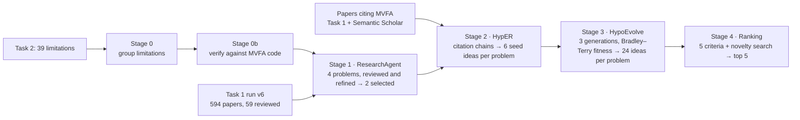

# Task 3 — Research Problem Discovery and Ideation for MVFA

Task 3 of the *Introduction to Large Language Models* course project. Starting from the 39 limitations of our base paper, **MVFA**, that our Task 2 pipeline identified, and the literature collected by our Task 1 pipeline, this pipeline:

1. formulates **two fine-grained research problems** (with **ResearchAgent**);
2. generates **literature-grounded research ideas** for each problem (with **HypER**);
3. **evolves** the ideas with a genetic algorithm (with **HypoEvolve**);
4. **ranks** them on Novelty, Feasibility, Clarity, Impact and Validity, and selects the **top 5 per problem**.

Our base paper is MVFA: *Adapting Visual-Language Models for Generalizable Anomaly Detection in Medical Images*, CVPR 2024 ([paper](https://arxiv.org/abs/2403.12570), [code](https://github.com/MediaBrain-SJTU/MVFA-AD)).

| Deliverable | Where |
|---|---|
| Submission document (problems, ranking tables, top-5 ideas in full) | [`reports/Task3_Submission.pdf`](reports/Task3_Submission.pdf) |
| Full documentation (every stage, every decision, limitations, future work) | [`reports/Task3_Documentation.pdf`](reports/Task3_Documentation.pdf) |
| Interactive explorer of all intermediate results | [`explorer/mvfa_idea_explorer.html`](explorer/mvfa_idea_explorer.html). Download it and open it in a browser. |
| Every prompt and every model answer | `logs/cache/` (all runs) and `logs/calls.jsonl` (this run, plus the independent re-judge's calls, tagged `rejudge/`) |

---

## Results

This is **run 3**, built on Task 1's run-v6 output and Task 2's structured limitations. As agreed in the team, problems were generated only for the two directions Task 4 builds on: **label supervision** (group A) and **scoring** (group B).

The rankings below come from the pipeline's own judge. An independent judge (Gemini 3.8 Flash) keeps 3 of the 5 B1 ideas (B1-g2-o1, B1-g2-o4, B1-g3-o5) and none of the 5 A1 ideas in its top 5; see [Independent checks](#independent-checks).

### Problem 1 (B1): inductive per-image scoring for few-shot MVFA

> In the released code, MVFA's few-shot inference min-max normalises its text branch and its memory-bank branch with the minimum and maximum of the **whole test set**, so one image's score depends on the other test images and a single new image cannot be scored. Can this be replaced by a normaliser built only from the K normal support images (leave-one-out scores), keeping the 0.5 fusion and max pooling fixed, at a small cost in AUROC?

Stage 1 score: 4.0 → **4.4** → 4.2 over the three rounds (best version kept).

| # | ID | Idea | Review mean (1–5) | Final score |
|---|---|---|---|---|
| 1 | B1-g2-o1 | **Alignment-adaptive residual CDF:** subtract a per-position normal score measured on the supports, weighted by how well the modality is aligned | 4.0 | 0.825 |
| 2 | B1-g3-o4 | **Content-conditioned normal-score regression:** a small model trained on source normals predicts each patch's expected normal score | 4.0 | 0.776 |
| 3 | B1-g2-o4 | **Extreme-value tail** for the support CDF, so scores above every support score are still ordered | 4.0 | 0.676 |
| 4 | B1-g3-o5 | **Exact leave-one-out** version of idea 1, removing a small-K bias in the thresholds | 3.8 | 0.671 |
| 5 | B1-g1-o5 | **Split-conformal thresholds** from the supports, with a distribution-free false-positive bound | 3.8 | 0.611 |

### Problem 2 (A1): training MVFA's segmentation adapters from image-level labels

> In the released code, the segmentation adapters (the only part that produces anomaly maps) learn only from the three BMAD datasets with pixel masks. Can they be trained from **image-level labels alone** with a multiple-instance (top-k) loss on all five source datasets, and how much of the mask-supervised localisation on the unseen modality does that keep?

Stage 1 score: 4.0 → 4.2 → **4.2**.

| # | ID | Idea | Review mean (1–5) | Final score |
|---|---|---|---|---|
| 1 | A1-g1-o2 | **Normal-bank-gated MIL:** choose the supervised patches by their distance to a bank of normal patches, so normal anatomy is not picked | 3.8 | 0.790 |
| 2 | A1-g3-o3 | **Gated mosaic MIL:** four-image mosaics give free quadrant labels, combined with idea 1 | 3.8 | 0.744 |
| 3 | A1-g1-o6 | **Witness-rate-adaptive MIL:** estimate each dataset's lesion fraction from image labels and use it as k | 3.8 | 0.708 |
| 4 | A1-g2-o2 | **Mosaic MIL:** free quadrant-level labels from mosaics of labelled images | 4.0 | 0.682 |
| 5 | A1-g3-o2 | **Per-image k** from the number of patches far from the normal bank | 3.4 | 0.606 |

How the scores are computed:
- **Final score** = 0.7 × normalised review mean + 0.3 × normalised evolutionary fitness.
- At most two ideas from the same method family can enter a top 5.
- Each idea in the submission PDF comes with:
  - a hypothesis with the result that would falsify it;
  - a step-by-step method that names the MVFA files to change;
  - an experiment design;
  - the reviews and the closest prior work;
  - its lineage.

---

## Pipeline



| Stage | Script | What it does | Output |
|---|---|---|---|
| 0 | `stage0_gaps.py` | Reads Task 2's 39 limitations and groups them | `outputs/stage0_gaps.json` |
| 0b | `stage0b_verify.py` | Checks every implementation claim against MVFA's code, with file:line evidence (no LLM) | `outputs/stage0b_code_verification.json`, `outputs/gaps_verified.json` |
| 1 | `stage1_problems.py` | ResearchAgent: problem generation, five-criterion reviews with human-induced rubrics, two refinement rounds | `outputs/stage1_problems.json` |
| 2 | `stage2_hyper.py` | HypER: relevance-scored citation chains and one seed idea per chain, with provenance | `outputs/stage2_chains.json`, `outputs/stage2_seeds.json` |
| 3 | `stage3_evolve.py` | HypoEvolve: crossover and mutation by LLM, pairwise judging, Bradley–Terry fitness, (μ+λ) selection | `outputs/stage3_evolution_{A1,B1}.json` |
| 4 | `stage4_rank.py` | Reviews on five criteria, method families, diversity rule, final top 5 | `outputs/stage4_ranking_{A1,B1}.json` |

**Code verification found discrepancies between the paper and the released code.** Of the ten Task 2 limitations it could test, the code confirmed four, answered three open questions, showed two to be worse than stated and corrected one. It also added four code-only limitations:
- C1: scores are normalised with the test set's min and max;
- C2: checkpoints are selected on the target test set;
- C3: the loss uses mean pooling, while the paper says max pooling;
- C4: the learning rate and batch size differ from the paper.

These findings shaped both problems. They are listed with links to the exact lines in the documentation (section 5.2).

---

## Quick start

Python 3.10 or newer.

```bash
cd task3
pip install -r requirements.txt
python3 run_all.py
```

`run_all.py` replays the whole run from `logs/cache`. It needs no API key and makes no new model calls, so every number in the reports can be regenerated.

To rebuild the explorer and the PDFs:

```bash
python3 export_explorer_data.py   # outputs/explorer_data.json + explorer/mvfa_idea_explorer.html
python3 make_reports.py           # reports/*.pdf (needs xelatex with TeX Gyre Pagella/Heros and DejaVu Sans Mono fonts)
```

### Running with a real API model

All model calls go through `llm_client.py`. Each call has a role, either `generator` or `judge`, and is cached by a hash of (model and its request settings, prompt, sample index).

```bash
# any OpenAI-compatible endpoint (Groq, AgentRouter, OpenAI, ...)
export LLM_BACKEND=openai
export LLM_BASE_URL=https://api.groq.com/openai/v1
export LLM_API_KEY=...            # never commit keys; they are read from the environment only
export LLM_MODEL=openai/gpt-oss-120b   # llama-3.3-70b-versatile was retired on Groq's free tier in August 2026
python3 run_all.py
```

`JUDGE_BACKEND`, `JUDGE_BASE_URL`, `JUDGE_API_KEY` and `JUDGE_MODEL` override the `LLM_*` settings for judge calls only. Optional: `*_CONCURRENCY` (parallel requests; 1–2 for rate-limited APIs, 8–32 for a local vLLM server), `*_MAX_TOKENS`, and `*_EXTRA_BODY` (JSON added to each request, e.g. to switch Qwen3's thinking off).

### Independent checks

The same model (Claude) generated and judged everything in this run, as in ResearchAgent and HypoEvolve, so the judgments could share the generator's preferences. Two checks were run afterwards with models from elsewhere. Neither changes the run's outputs; both measure how far other judges agree with ours. The documentation (section 8) has the full account.

| Check | What it is | Where it ran | Result file |
|---|---|---|---|
| Independent judge | Gemini 3.8 Flash answers every judging prompt of stages 1–4 again, plus every comparison with the two ideas swapped | API calls to Google's Gemini API (`rejudge.py`) | `outputs/rejudge_gemini-3.8-flash.json` |
| HypER's distilled checker | Phi-3-mini fine-tuned with LoRA on HypER's released chains, used to re-check Stage 2 | A free GPU: a Modal A100 40 GB on its free monthly credit (`colab/modal_hyper.py`) | `outputs/stage2b_hyper_check.json`, `outputs/hypercheck_*.json` |

#### 1. Re-judging with Gemini 3.8 Flash

**Why.** A judge tends to agree with its own way of writing and reasoning. If a model from another company, given exactly the same prompts, reaches the same scores and choices, the run's judgments don't depend on the judge being Claude. Where it doesn't, we can say which conclusions depend on the judge.

**What was re-asked.** `rejudge.py` reads `logs/calls.jsonl` (the list of every call this run made) and picks the judge calls of stages 1–4, plus the second-hop relevance chunks this run reused from run 2's cache. It sends the identical system prompt, user prompt and temperature to the new model, so any difference comes from the judge alone. Three judge calls aren't re-asked because they aren't quality judgments: one grouped Task 2's limitations, and two named the method families of the shortlisted ideas.

| Stage | What the judge does | Prompts | Answers compared |
|---|---|---|---|
| 1 | Rates 4 candidate problems, each in 3 versions, on 5 criteria (one call per criterion, 1–5) | 60 | 60 ratings |
| 2 | Scores the relevance (0/1/2) of the papers citing MVFA and of the second-hop papers, several per call | 17 | 167 scores |
| 3 | Picks the stronger of two ideas: all 15 pairs of the 6 seeds, then 51 new pairs in each later generation | 336 | 336 winners |
| 4 | Reviews each of the 12 shortlisted ideas per problem on 5 criteria | 24 | 120 ratings |
| 3, swapped | The same 336 comparisons with Idea A and Idea B exchanged (`stage3swap`) | 336 | 336 winners |
| **Total** | | **773** | |

**Measures.**
- **Spearman correlation:** whether two judges put items in the same order (1 = same order, 0 = unrelated).
- **Exact agreement / within one point:** the share of identical ratings, or ratings at most one point apart.
- **Weighted kappa:** agreement on 0/1/2 relevance beyond chance, where a 0-versus-2 disagreement counts more than 0-versus-1. Above 0.6 is usually called substantial.
- **Winner agreement:** the share of comparisons where both judges pick the same idea (0.5 is chance).
- **Self-consistency:** how often Gemini picks the same idea when the order is swapped.
- **Top-5 overlap**, in three versions: Gemini's reviews with our tournament fitness; Gemini's reviews with Gemini's tournament; and Gemini's reviews with Gemini's both-orders tournament. All three keep our 12-idea shortlist, the 0.7/0.3 weights and the limit of two ideas per method family.

**Results.**

| Check | Result |
|---|---|
| Stage 1 problem reviews (60) | Spearman 0.70; within one point 98%; Gemini scores higher (4.42 vs 3.93) |
| Stage 2 relevance (167 papers) | same score 77%; weighted kappa 0.68 |
| Stage 3 comparisons (168 per problem) | same winner 57% (A1), 60% (B1); no ties from either judge |
| Stage 3, both orders | Gemini consistent with itself 92% (A1) / 91% (B1); first-shown idea wins 51% / 54% |
| Top 5, Gemini's reviews + our tournament | A1: 5 of 5 kept; B1: 4 of 5 |
| Top 5, Gemini's reviews + Gemini's both-orders tournament | B1: 3 of 5 kept (B1-g2-o1, B1-g2-o4, B1-g3-o5); A1: 0 of 5 |

**What it means.**
- **The two judges agree on absolute scores:** which problems are strong and which papers are relevant.
- **They disagree on which of two close ideas is stronger, and this isn't noise.** Gemini is consistent with itself, and neither judge favours the idea shown first. The ideas in a generation are close in quality, and the two judges weigh the criteria differently.
- **B1 holds.** For B1, three of the five selected ideas are also in Gemini's top 5, including our first one.
- **A1 doesn't.**
  - Gemini's A1 top 5 is the shortlisted ideas we ranked 7–12: posterior-weighted, consensus, co-teaching and matched-pair MIL variants.
  - Its tournament winner is a seed (A1-g0-C1), so by its judgement evolution didn't improve on A1's seeds.
  - The order within A1 is therefore one judge's preference.

**Limits.**
- There was one second judge, asked once, at low reasoning effort.
- Gemini rates more generously on average.
- Its reviews cover only our 12 shortlisted ideas per problem. So A1-g0-C1, which is outside the shortlist, was never reviewed, and the fully independent top 5 still uses our shortlist and our method families.

**How to reproduce.** The calls go through Google's Gemini API (OpenAI-compatible endpoint), from `task3/`:

```bash
export JUDGE_BACKEND=openai
export JUDGE_BASE_URL=https://generativelanguage.googleapis.com/v1beta/openai/
export JUDGE_API_KEY=...            # set only in the terminal; never written to a file
export JUDGE_MODEL=gemini-3.8-flash
export JUDGE_CONCURRENCY=2
export JUDGE_MAX_TOKENS=2048
export JUDGE_EXTRA_BODY='{"reasoning_effort": "low"}'
python3 rejudge.py stage1 stage2 stage3 stage3swap stage4
```

Answers are cached in `logs/cache/`, so the same command replays for free.

#### 2. HypER's distilled checker (Phi-3 + LoRA) on Modal

**Why.** HypER has two halves:
- A large model builds citation chains and scores how far each paper depends on the one it cites.
- The authors then fine-tune a small model, Phi-3-mini-128k-instruct, on those chains, so it can check new chains cheaply.

Our Stage 2 ran only the first half, with Claude as the large model. Training the second half and running it on our chains gives a check of Stage 2 by a model that learned HypER's notion of relevance from HypER's own data, not from our judge. In HypER's relevance prompt:
- **2** means the paper's key hypothesis at least partly depends on the source paper's findings;
- **1** means the paper is related;
- **0** means it isn't related.

**Three tasks.** [`colab/hyper_checker.py`](colab/hyper_checker.py) rebuilds HypER's multi-task data from its released chains (9,102 training examples). The checker answers in JSON for three tasks:
- **1-hop relevance:** score one paper against the paper it cites, 0/1/2;
- **chain validity (c1):** is a whole chain valid, and which papers break it;
- **hypothesis support (c2):** does a chain support a given hypothesis.

The same formats are built for our Stage 2: 158 papers citing MVFA, 9 second-hop papers, our 6 chains, and the 12 seed ideas (6 per problem, one per chain).

**How it was run.** On a free GPU: an A100 40 GB on [Modal](https://modal.com), covered by its free monthly credit, with [`colab/modal_hyper.py`](colab/modal_hyper.py) (the same scripts and settings as the Colab notebook). Training took about 1 hour 45 minutes. Settings compared with HypER's:

| Setting | HypER's released configuration | This run |
|---|---|---|
| Base model | Phi-3-mini-128k-instruct | same |
| LoRA | r 8, alpha 16, dropout 0.05, all linear layers | same |
| Optimisation | lr 2e-4, cosine schedule, 10 warm-up steps, micro-batch 1, gradient accumulation 4, loss on the answer only | same |
| Precision | 8-bit loading | bf16 weights |
| Maximum length | 16,384 tokens | 8,192 tokens (464 of 9,102 examples longer, skipped) |
| Training | 10 epochs on 8 GPUs | 1 epoch on one A100 40 GB: 8,638 examples, 2,160 optimizer steps |

**Did the training work?** Yes. Both models answered a stratified sample of HypER's test split, 100 questions per task. Each cell shows macro F1 / accuracy / unreadable answers:

| Task | Base Phi-3 | Fine-tuned checker |
|---|---|---|
| 1-hop relevance (0/1/2) | 0.268 / 0.23 / 0 | 0.559 / 0.86 / 0 |
| Chain validity (c1) | 0.745 / 0.73 / 6 | 0.820 / 0.82 / 0 |
| Hypothesis support (c2) | 0.459 / 0.46 / 23 | 0.877 / 0.88 / 0 |
| **Average macro F1** | **0.491** | **0.752** |

HypER reports 0.47 → 0.62 on its full test set. The fine-tuned checker never predicts the middle score 1, which only 5 of the 100 test papers have.

**Results on our Stage 2.**

| Check | Result |
|---|---|
| Relevance of the 158 papers citing MVFA | same score as our judge for 49%; weighted kappa 0.21 |
| Relevance of the 9 second-hop papers | same score for 22%; weighted kappa 0.18 |
| Chain-starting papers the checker scores 0 | none |
| Chain validity | all 6 chains valid |
| Seeds supported by their chain | 12 of 12 |

Relevance of the papers citing MVFA, our judge (rows) against the checker (columns):

| | checker 0 | checker 1 | checker 2 |
|---|---|---|---|
| ours 0 | 70 | 0 | 57 |
| ours 1 | 0 | 0 | 24 |
| ours 2 | 0 | 0 | 7 |

**What it means.**
- **The disagreement goes one way.** The checker scores 2 for 57 papers our judge scored 0, mostly anomaly-detection and CLIP-adaptation papers that share MVFA's topic.
- **It never scores 0 a paper our judge found relevant,** and every chain-starting paper is relevant to it too.
- **It raises no objection to Stage 2:** it finds all six chains valid and all twelve seeds supported. But it answered "valid" every time on our data, so this is weak evidence either way.
- **The gap mostly measures domain transfer.** HypER's training chains come from clinical-trial literature, and the checker is being applied to computer-vision papers.

**Limits.**
- One epoch instead of ten, inputs cut at 8,192 tokens instead of 16,384, and bf16 instead of 8-bit loading.
- The test comparison uses 300 of HypER's test questions, not all of them.
- The checker was trained on clinical-trial chains and applied to computer vision.
- It never said "invalid" on our chains and seeds, so those two results can't tell good chains from bad ones.

**How to reproduce** (from `task3/`, after `pip install modal` and `modal setup`, with a Modal account that has credit):

```bash
modal run colab/modal_hyper.py --step smoke     # 10-minute test of the whole chain
modal deploy colab/modal_hyper.py               # once, and again after editing the script
modal run colab/modal_hyper.py --step start     # training (~1 h 45 min) on Modal; the laptop can sleep
modal run colab/modal_hyper.py --step eval      # laptop open, about 20 minutes
modal run colab/modal_hyper.py --step mvfa      # laptop open, a few minutes
python3 stage2b_hyper_check.py && python3 make_reports.py
```


### How this run was produced

This run used the **file backend**:
1. Each missing answer was written to `logs/pending/`.
2. The configured model (Claude, `claude-opus-5-5`) answered it as generator or judge.
3. The answers were ingested with `python3 llm_client.py ingest`.

The run made **502 new model calls** and reused **1** from an earlier run. The scripts that wrote the answers are kept in `logs/answers/run3/` for auditability.

---

## Settings you can change

| File | Setting | Default | Meaning |
|---|---|---|---|
| `stage3_evolve.py` | `BOTH_ORDERS` | `False` | `True` judges each pair in both orders to correct position bias (about 1.8× the calls) |
| `stage3_evolve.py` | `MU`, `LAMBDA`, `G`, `PC`, `PM` | 6, 6, 3, 0.6, 0.15 | HypoEvolve population size, offspring per generation, generations, crossover and mutation probabilities |
| `stage4_rank.py` | `SHORTLIST`, `TOP_K`, `MAX_PER_FAMILY` | 12, 5, 2 | Ranking pool, ideas selected, diversity limit |
| `stage4_rank.py` | `W_REVIEW`, `W_FIT` | 0.7, 0.3 | Weights of the review mean and the fitness in the final score |
| `stage2_hyper.py` | `BRANCHES`, `HOP2_PREFILTER` | 6, 20 | Number of citation chains; second-hop candidates per chain |
| `stage1_problems.py` | `GROUPS`, `N_REFINE` | A, B; 2 | Limitation groups used for problems; refinement rounds |

---

## Repository layout

```
task3/
├── run_all.py               # runs every stage in order (replays from cache by default)
├── llm_client.py            # file / OpenAI-compatible backends, roles, cache
├── answer.py                # helper for answering pending prompts (file backend)
├── corpus.py                # Task 1 loader, review set, MVFA-citing papers, OpenAlex entity store (ResearchAgent Eq. 2)
├── stage0_gaps.py … stage4_rank.py
├── rejudge.py               # independent re-judging with another model
├── fetch_citations.py       # Semantic Scholar forward citations (run locally; standard library only)
├── novelty_search.py        # re-runs the Stage 4 novelty queries on Semantic Scholar
├── stage2b_hyper_check.py   # optional: agreement of HypER's Phi-3 checker with our Stage 2
├── colab/                   # Colab notebooks (independent judge, HypER Phi-3 checker), their scripts, and modal_hyper.py
├── export_explorer_data.py  # builds outputs/explorer_data.json and the explorer page
├── make_reports.py          # builds both PDFs from the outputs
├── prompts/                 # all prompt templates; ResearchAgent rubrics verbatim; HypER relevance prompt from its released code
├── data/
│   ├── task1/final_ref_set.json    # Task 1 run-v6 corpus (594 papers, 59 selected = review set)
│   ├── task2/final_limitations.json # Task 2's 39 limitations (task2 branch, full_nim result)
│   ├── inputs_manifest.json        # which Task 1 and Task 2 versions this run used
│   ├── s2_citations.json           # papers citing MVFA (Semantic Scholar)
│   ├── novelty_search.json         # novelty evidence for the shortlisted ideas
│   ├── mvfa_code/                  # snapshot of MVFA's public code (MIT licence) used for code verification
│   └── unused/                     # superseded Task 1 files, kept for reference
├── outputs/                 # results of every stage (JSON)
├── reports/                 # Task3_Submission.pdf, Task3_Documentation.pdf
├── explorer/                # interactive explorer (template + built page)
├── logs/                    # calls.jsonl, cache/ (every prompt and answer), answers/
└── runs/                    # archived runs 1 (SurveyGen corpus) and 2 (QUAL-SG corpus)
```

---

## Methods and how faithfully they are implemented

- **ResearchAgent** ([arXiv:2404.07738](https://arxiv.org/abs/2404.07738)). Faithful parts:
  - the problem-identification prompt and the ReviewingAgent prompts, with one call per criterion;
  - the human-induced rubrics, copied verbatim;
  - entity retrieval by Eq. 2;
  - iterative refinement.

  Adaptations:
  - the limitation group is an extra input;
  - entities are the OpenAlex keywords and topics of the Task 1 papers, instead of BLINK entity linking.
- **HypER** ([arXiv:2506.12937](https://arxiv.org/abs/2506.12937)). Faithful parts:
  - the released relevance prompt (0/1/2) with the authors' few-shot examples;
  - the 2-year citation window;
  - candidate scoring 0.7·relevance + 0.3·citations;
  - the generation prompt with provenance.

  Adaptation: with a single source paper, the six best first-hop papers each start a chain. The distilled small model (Phi-3 + LoRA) was trained afterwards on Modal and used as a second opinion on Stage 2 (see [Independent checks](#independent-checks)).
- **HypoEvolve** ([arXiv:2609.15938](https://arxiv.org/abs/2609.15938)). Implemented as Algorithm 1 with the paper's settings:
  - μ = λ = 6, three generations;
  - combination and inspiration crossover;
  - substitution and out-of-box mutation;
  - all-pairs judging with Bradley–Terry fitness.

## Limitations

- The same model generated and judged the ideas. Mitigations:
  - code verification and a literature novelty search as non-LLM evidence;
  - an independent re-judge with Gemini 3.8 Flash (agrees on absolute scores, not on the order of close ideas; see above);
  - HypER's distilled checker, trained on Modal (finds all chains valid and every seed supported, but is more lenient on relevance than our judge; see above).
- In the pipeline's own Stage 3 each pair of ideas was shown once, in one order, as in HypoEvolve. The both-orders check was run on the independent judge: Gemini judged every pair in both orders and picked the idea shown first only 51–54% of the time, so position bias is small. Switching the pipeline itself to both orders (`BOTH_ORDERS = True`) would mean re-running Stages 3–4.
- No idea has been run yet. Each hypothesis states the result that would falsify it, to be tested in the next assignment.
- This is the third run of the pipeline. Runs 1 and 2 are archived in `runs/`. The same model produced all three, so they are not independent.
- Task 2's limitations were produced from Task 1's run v4, not v6. The limitations used for the two problems come mainly from the MVFA paper itself, so the effect is small.

See sections 8–10 of the documentation for the independent checks, the full list of limitations and the changes that can be made.

## Acknowledgements

- MVFA code snapshot © 2024 MediaBrain-SJTU, MIT licence (`data/mvfa_code/LICENSE`).
- HypER relevance prompt and few-shot examples from [rosnikv/HypER](https://github.com/rosnikv/HypER).
- Citation data from the [Semantic Scholar API](https://www.semanticscholar.org/product/api).
