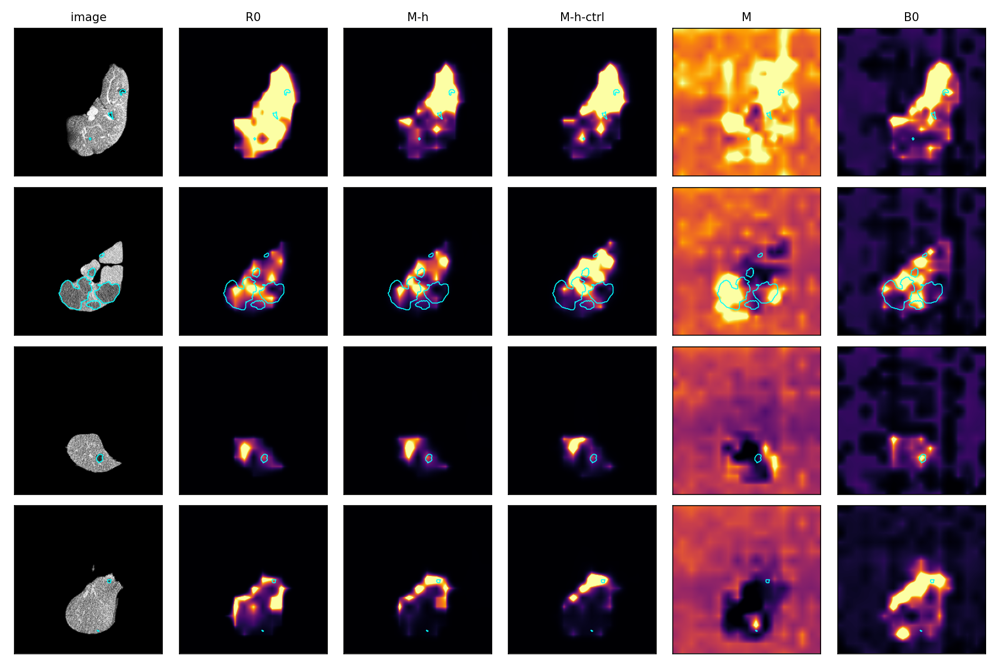

# Task 4 report: a PU loss for MVFA's mask-less datasets

Plan: `TASK4_PLAN_RECOMMENDED.md` (copied into the repository root). All runs were done on 2026-11-22 on 2 × RTX PRO 6000 Blackwell. Every
deviation from the plan was written down in [`DECISIONS.md`](DECISIONS.md) on 2026-11-21, **before any GPU run
or any target result**. Everything else follows the plan, including the pre-registered Step 5 rules,
which `analyze.py` applies mechanically. The numbers below are copied from
[`paper_inputs/`](paper_inputs/), which `make_paper_inputs.py` builds from `results/results.csv`.

**In one paragraph.**
- **Fine-tuning comparison: no effect.** Under the pre-registered rules, adding a PU loss on MVFA's three mask-less datasets does **not** improve localisation beyond plain fine-tuning. AUPRO rises in 6 of 9 paired runs (one-sided sign test p = 0.25). The effect is large and consistent on Brain MRI (+5.2 AUPRO, 3/3 seeds), absent on Liver CT, and unstable on RESC.
- **Mask-free comparison: masks still matter.** A model whose segmentation adapters are trained with the PU loss and no masks keeps on average 58% of MVFA's pixel-AUROC margin over chance. It collapses to chance on Liver CT, and it never beats plain top-k MIL.
- **Not pre-registered, but clear in the same data: the mask-free baseline B0 (top-k MIL) keeps 93–99% of R0's localisation on all three targets.**

## 1. Idea and refinement

- **Origin.** The idea is **run 3's witness-rate-adaptive MIL** (`A1-g1-o6`: problem A1, top-5 idea #3). Patches of an abnormal image are a mixture of normal-looking and anomalous ones, and the mixture rate ("witness rate") should set how strongly the image label is pushed onto patches.
- **Refinement.** Run 1 (`A1-g2-o6`) turned it into a **positive-unlabelled (PU) loss**. Patches of normal images are labelled negatives (N). Patches of abnormal images are unlabelled (U), containing a fraction π of positives. The non-negative PU risk is (1 − π)·mean_N ℓ(z, 0) + max(0, mean_U ℓ(z, 1) − (1 − π)·mean_N ℓ(z, 1)).
- **This task's version (M-h).** A hybrid fine-tune of MVFA's segmentation adapters from its released zero-shot checkpoint:
  - MVFA's own Dice + Focal mask loss on the masked sources;
  - plus λ × PU on the three datasets that MVFA trains on with **image labels only** (OCT2017, Chest X-ray, histopathology).

  The control M-h-ctrl is the same fine-tune without the PU term. A second question is how much localisation survives with **no masks at all**:
  - M: PU loss only, fresh segmentation adapters;
  - B0: the same with plain top-k MIL.
- **Why this idea:**
  - it can be tested cheaply and cleanly (warm start, fixed budget, a paired control that differs only in the PU term);
  - it uses data that MVFA leaves unused for localisation;
  - and the mask-free variant asks a question MVFA's paper does not answer.

## 2. Issues log

The full log, one row per issue (*issue → how found → feedback given to the LLM → fix*), is
[`ISSUES_LOG.md`](ISSUES_LOG.md). It has 29 rows: A1–A6 are the items the plan asked for, B1–B16 were
found while implementing and running, and C1–C7 are errors in the LLM's own first versions that the
checks caught. The issues that shaped the results:

| # | Issue | Outcome |
|---|---|---|
| A1 | Half-written PU formula | Implemented as non-negative PU risk in "NU" form, on z = s₁ − s₀ (so sigmoid(z) equals MVFA's patch probability); checked against a hand calculation |
| A2 | Batch size 1 vs PU's need for paired images | One normal + one abnormal image from the same dataset per PU step. Found that **MVFA's own forward crashes at batch > 1**; rewrote it and tested equivalence at batch 1 |
| A3 | Where to estimate π | R0, held-out 10%, deepest level, as planned. Superseded by A4/B11 |
| A4 | The π estimator's instability on small tails | **The plan's formula is wrong** (the ratio is ≥ 1, so it returns ≈ 1). Corrected to lower tails with F_norm ∈ [0.10, 0.50] and a 1-SE threshold choice; it passes the plan's synthetic check (0.10 ± 0.03) |
| A5 | MVFA's test-set model selection | Our runs keep the last step. R0 still inherits the bias (see limitations) |
| A6 | Full retrain too expensive → warm start | All six released checkpoints exist; no retraining |
| B1 | MVFA's zero-shot "training" data is each source's `test/` folder | Followed MVFA; the target's files are never used (leakage check by path and MD5) |
| B2 | MVFA's detection adapters also receive mask gradients | So the plan's M (R0 detection adapters) is not mask-free. **D3:** M and B0 retrain both adapter sets without masks; the plan's version runs as a secondary variant |
| B4 | λ = 0 is not a no-op with Adam | **D5:** M-h-ctrl skips the PU iterations (identical mask updates in identical order) |
| B10, B11 | **The π estimator does not work on MVFA's patch scores**, even against ground truth | At deep levels every patch of an abnormal image outscores normal-image patches, so the mixture assumption fails (true fractions 0.008–0.119; estimates ≈ 1). **D1:** M-h uses the true anomalous-patch fraction of its masked sources. **D2:** M uses 0.30, the value the plan's procedure returns |
| B12 | MVFA's detection loss feeds a probability to `BCEWithLogitsLoss` | Replicated unchanged (D4) |
| B14 | Training is much cheaper than budgeted | 0.018 s per update; 6 concurrent jobs per GPU (pre-set throughput rule) |
| B15 | R0 reproduces MVFA's **released checkpoint** exactly, not the paper | All six AUROCs match the README's "Implementation" column to ±0.01 |

## 3. Results

All numbers are in % (×100). Runs evaluate the **last** training step on the full target test set.
Pixel AUROC and AUPRO (FPR ≤ 0.3, per-region overlap) are computed over all test pixels.

### (a) M-h vs M-h-ctrl (S = 2,000, λ = 1, seeds 0–2; mean ± std)

| target | model | n | img AUROC | pix AUROC | AUPRO |
|---|---|---|---|---|---|
| Liver | R0 (paper) | – | 76.24 | 97.85 | – |
| Liver | R0 (reproduced) | 1 | 81.19 | 97.92 | 92.34 |
| Liver | M-h | 3 | 80.29 ± 0.63 | 96.97 ± 0.18 | 91.39 ± 0.27 |
| Liver | M-h-ctrl | 3 | 81.63 ± 0.37 | 96.99 ± 0.31 | 91.07 ± 0.41 |
| Brain | R0 (paper) | – | 78.63 | 90.27 | – |
| Brain | R0 (reproduced) | 1 | 79.80 | 89.68 | 65.35 |
| Brain | M-h | 3 | 80.25 ± 0.72 | 91.71 ± 0.71 | 71.57 ± 2.07 |
| Brain | M-h-ctrl | 3 | 80.31 ± 0.96 | 90.05 ± 0.74 | 66.38 ± 2.12 |
| RESC | R0 (paper) | – | 83.31 | 92.05 | – |
| RESC | R0 (reproduced) | 1 | 88.99 | 90.44 | 68.75 |
| RESC | M-h | 3 | 89.20 ± 0.16 | 88.76 ± 2.69 | 67.45 ± 6.15 |
| RESC | M-h-ctrl | 3 | 88.92 ± 0.08 | 89.76 ± 0.46 | 66.94 ± 1.14 |

**Paired Δ = M-h − M-h-ctrl (points)**

| target | seed | Δ img AUROC | Δ pix AUROC | Δ AUPRO |
|---|---|---|---|---|
| Liver | 0 | −2.43 | +0.20 | +0.66 |
| Liver | 1 | −0.65 | −0.15 | −0.13 |
| Liver | 2 | −0.93 | −0.12 | +0.44 |
| Brain | 0 | −1.55 | +1.73 | +5.42 |
| Brain | 1 | +1.76 | +1.66 | +5.35 |
| Brain | 2 | −0.41 | +1.58 | +4.82 |
| RESC | 0 | +0.45 | −1.82 | −1.92 |
| RESC | 1 | +0.03 | +1.54 | +6.27 |
| RESC | 2 | +0.36 | −2.72 | −2.83 |
| **mean** | | Liver −1.34, Brain −0.07, RESC +0.28 | Liver −0.02, Brain +1.66, RESC −1.00 | Liver +0.32, Brain +5.20, RESC +0.51 |

**π per mask-less source.** M-h used π from D1, the true anomalous-patch fraction of the run's masked sources. That gives the same value for every mask-less source of a target: Liver 0.0647, Brain 0.0636, RESC 0.0092. The plan's estimator (segmentation branch, report only) gave these raw values:

| target | OCT2017 | Chest | Histopathology |
|---|---|---|---|
| Liver | 1.000 | 0.100 | 0.986 |
| Brain | 0.949 | −0.058 | 0.756 |
| RESC | 1.000 | −0.017 | 0.941 |

### (b) Mask-free: M and B0 (both adapter sets trained from scratch without masks; D3)

| target | model | n | img AUROC | pix AUROC | AUPRO | retention (pix − 50)/(R0 − 50) | AUPRO / R0 |
|---|---|---|---|---|---|---|---|
| Liver | M | 3 | 73.79 ± 2.52 | 59.45 ± 15.51 | 26.28 ± 15.50 | −0.002 (s0) | 0.188 (s0) |
| Liver | B0 | 1 | 75.17 | 94.42 | 85.47 | 0.927 | 0.926 |
| Brain | M | 1 | 68.87 | 89.87 | 64.50 | 1.005 | 0.987 |
| Brain | B0 | 1 | 63.51 | 89.46 | 64.53 | 0.994 | 0.987 |
| RESC | M | 1 | 84.53 | 80.13 | 58.52 | 0.745 | 0.851 |
| RESC | B0 | 1 | 76.98 | 89.57 | 67.29 | 0.979 | 0.979 |

The three Liver seeds of M give pixel AUROC 49.90 / 77.34 / 51.10. M's π was fixed at 0.30 for every source (D2). The plan's detection-branch estimator, report only, gives raw values of 0.69–1.00 for 12 of the 15 target-source pairs and −0.51–0.48 for Chest ([`paper_inputs/table_b_pi.md`](paper_inputs/table_b_pi.md)).

### Liver heat maps

The four images are the abnormal Liver test images with masks at positions 1/8, 3/8, 5/8 and 7/8 of the sorted list; that rule was fixed before any map was viewed. The cyan line is the ground truth. Each column has one colour scale, its model's 1st–99.5th percentile.
- R0, M-h, M-h-ctrl and B0 all light up regions inside the organ.
- **M lights up the empty background around the organ and scores the liver low.** That explains its chance-level pixel AUROC: what it learned separates image types, not lesions.

### Secondary runs (not used by any Step 5 rule)

| run | pix AUROC | AUPRO | img AUROC | compared with |
|---|---|---|---|---|
| M-h, Liver s0, π = 0.30 (what the plan's estimator gives; D1 sensitivity) | 95.99 | 89.59 | 80.22 | M-h s0: 96.88 / 91.26 |
| M, Liver s0, π = 0.05 (**chosen after seeing mask statistics**; D2 sensitivity) | 97.14 | 87.28 | 69.28 | M s0: 49.90 / 17.33 |
| M, Liver s0, 2S = 4,000 steps (plan's under-training check) | 59.88 | 36.19 | 63.41 | M s0: 49.90 / 17.33 |
| M with R0's detection adapters (the plan's M; not strictly mask-free, B2), Liver | 38.01 | 13.39 | 74.58 | M s0 |
| same, Brain | 87.02 | 57.23 | 81.86 | M s0: 89.87 / 64.50 |
| same, RESC | 82.11 | 60.19 | 87.25 | M s0: 80.13 / 58.52 |

## 4. Which Step 5 rules apply

**(a) PU on mask-less data vs fine-tuning alone: "No effect beyond fine-tuning" (negative result).**
- **The rule.** AUPRO Δ > 0 in 6 of 9 pairs, which falls in the "≤ 6 of 9" row (one-sided sign test p = 0.254). Mean Δ AUPRO is positive on all three targets (overall +2.01), but the count rule decides. Pixel-AUROC Δ is positive in only 5 of 9 pairs.
- **Early-stop check.** It was run on Liver after 3 seeds. The Δs were not all within ±0.3 with mixed signs (Δ AUPRO +0.66 at seed 0), so Brain and RESC were run with 3 seeds as planned. The λ = 0.5 exception did not apply (M-h > M-h-ctrl on Liver seed 0).
- **The honest reading** goes beyond the rule but does not contradict it:
  - the PU term gives a **large, seed-consistent gain on Brain MRI** (+1.7 pixel AUROC, +5.2 AUPRO, 3/3 seeds, roughly 2.5× the seed std);
  - nothing on Liver CT;
  - on RESC, one seed gains a lot and two lose (M-h's AUPRO std is 6.2 vs 1.1 for the control).

  Our data cannot tell whether the Brain gain comes from π (Brain and Liver use π ≈ 0.064, RESC 0.009), from the sources, or from chance across targets. It is a hypothesis, not a finding.
- **Side effect on image AUROC.** On Liver, M-h lowers image AUROC by 1.3 points relative to the control. The segmentation adapters feed the detection tokens through MVFA's residual mixing (B3).

**M-h vs R0: "does not match or exceed MVFA's released model".**
- M-h exceeds R0 only on Brain (pixel +2.02, AUPRO +6.22, image +0.45). On Liver it is −0.96 / −0.94 / −0.90 and on RESC −1.68 / −1.30 / +0.20.
- Plain fine-tuning (M-h-ctrl) is itself at or below R0 on Liver and RESC.
- Per the plan's caveat, R0 was selected on the test set, so this comparison favours R0 and is not a clean "beats MVFA" test either way.

**(b) Mask-free: "Masks still matter."**
- **The rule.** Mean pixel-AUROC retention of M over the 3 targets (seed 0) is **0.583** (< 0.8). It is 0.649 if Liver uses its 3-seed mean. M beats B0 on both pixel AUROC and AUPRO on **0 of 3** targets. Brain is a tie: M is +0.41 pixel AUROC and −0.03 AUPRO.
- **Per target:**
  - retention: Liver −0.002, Brain 1.005, RESC 0.745;
  - AUPRO ratio M / R0: 0.188, 0.987, 0.851.
- **Variability.** M varies a lot on Liver (pixel AUROC 49.9 / 77.3 / 51.1 over seeds). The M-vs-B0 comparison on Brain and RESC is single-seed.

**Not pre-registered, but the main positive observation.** Plain top-k MIL with **no masks at all** (B0) keeps a lot:
- retention 0.927 / 0.994 / 0.979 (mean 0.967);
- AUPRO ratio 0.93–0.99.

So "image labels alone go a long way" holds for **B0**. The pre-registered rule tested **M**, so we report this as an observation, to be confirmed with more seeds. B0's image AUROC is clearly below R0 (−6 to −16 points), because its detection adapters are trained from scratch for only S steps.

**Why M fails where B0 works (secondary evidence, interpreted with care):**
- With π = 0.30, the PU term tells the model that 30% of every abnormal image's patches are anomalous. On Liver CT (true lesion fraction ≈ 0.008) that is badly wrong, and the heat maps show M learning to flag background.
- With π = 0.05 the same run reaches pixel AUROC 97.1. That value was chosen after seeing the masked datasets' statistics, so it is **not** a valid mask-free result.
- Doubling the steps helps only a little (49.9 → 59.9).
- So the failure is mainly **π**, and the plan's π estimator cannot supply it (B11). That is the real obstacle for mask-free PU learning on these features.

**Honest conclusion.** On MVFA, the PU loss is not a reliable improvement over plain fine-tuning (positive on one of three targets). Mask-free PU learning is only as good as its π, and π cannot be estimated from MVFA's patch scores. Plain top-k MIL, which needs no π, already recovers most of MVFA's localisation without masks.

## 5. Limitations

- **Zero-shot only.** It follows MVFA's protocol: three targets, the other five datasets as sources.
- **Subsampled fine-tuning.** At most 500 + 500 images per source, from the sources' `test/` folders as in MVFA (B1).
- **3 seeds** for M-h / M-h-ctrl. The seed controls only data order; adapter initialisation and the subsample are fixed.
- **Starting checkpoints selected on the test set.** MVFA picked its released checkpoints on the target test set, so R0 and everything warm-started from it (M-h, M-h-ctrl) inherit that bias. M-h vs M-h-ctrl is clean; M-h vs R0 is not.
- **M and B0:**
  - single-seed outside Liver;
  - trained for S = 2,000 updates from scratch;
  - B0 Liver and B0 Brain were flagged as possibly under-trained (loss still falling);
  - M at 2S improved only slightly.

  The plan's ≤ 30-minute budget would have allowed a much larger S (one run took about 1.5 minutes of training on a shared GPU). We kept the plan's default S = 2,000 because S was fixed in advance.
- **RESC / OCT2017 overlap.** OCT2017, also retinal OCT, is a source when RESC is the target.
- **π is not estimated** (B11, D1, D2):
  - M-h uses the masked sources' true anomalous-patch fraction, which is mask information M-h already trains on;
  - M uses the 0.30 clip value;
  - both sensitivity runs are single-seed.
- **D3 changes the plan's M.** It retrains the detection adapters too, so the model is truly mask-free. M's image AUROC is therefore that of fresh detection adapters, not R0's. The plan's version was run as a secondary variant and is no better (table above).
- **Pixel metrics include the background.** On Liver CT most pixels are empty background. That is how MVFA evaluates, and it is what makes M's background-flagging so costly.

## 6. Compute and reproducibility

- **GPU time.** About 20 minutes wall-clock on 2 GPUs for everything, against a planned ≈ 14 GPU-hours. In total: 35 evaluated runs, 60 GPU-minutes summed over runs, with up to 6 runs sharing a card (B14, B16).
- **Code.** All code is in `task4/` (see [`../README.md`](../README.md)):
  - 27 pre-run checks (`tests/`) and a CPU end-to-end smoke test;
  - `run_all.sh` for the GPU phases;
  - `analyze.py` for the Step 5 rules;
  - `make_paper_inputs.py` for the tables and figure.
- **Records.** `results/results.csv` has one row per run, in the plan's format. Run outputs (adapters, loss curves, Liver maps) are on the HDD at `/mnt/HDD1/divyam/task4/runs/`.
- **Transcript.** The full conversation with the LLM that wrote the code is in [`transcript/TRANSCRIPT.md`](transcript/TRANSCRIPT.md).
- **Hand-off.** [`paper_inputs/`](paper_inputs/) holds:
  - `results.csv`, `paper_numbers.csv`, `pi.json`, `pi_maskfree.json` and the estimator outputs;
  - tables (a) and (b) as CSV and Markdown;
  - the Liver heat maps for R0, M-h, M-h-ctrl, M and B0 (PNG and PDF);
  - `analysis.md`.
