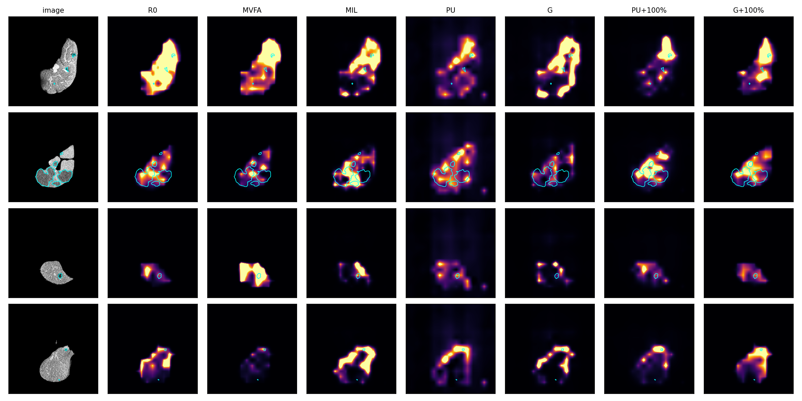

# Task 4, round 2: gated MIL (#1) and refined PU (#3) against a re-run MVFA

**Summary.** Round 2 trained every model from scratch under Task 3's protocol:
- leave-one-modality-out on BMAD, with RESC and OCT17 held out together;
- source-validation checkpoints;
- 3 seeds;
- 5 epochs on round 1's subsample.

Seven arms were run: mask-supervised MVFA, plain top-k MIL, Task 3's rank-1 idea (normal-bank-gated MIL, **G**), round 1's refined idea #3 (nnPU with a fixed π = 1 %, **PU**), and each new loss added to MVFA's mask training (**G+100 %**, **PU+100 %**), plus a π = 5 % sensitivity arm. The decision rules were fixed before any run (plan §6). Under them:
- **idea #1 is falsified:** G − MIL pixel AUROC is −5.3 on Brain, −1.2 on Liver and +4.3 on RESC;
- **refined #3 is not supported:** PU − MIL is −0.7 / −4.0 / −13.8;
- **no arm beats MVFA.** The closest is PU+100 %: AUPRO higher in 7 of 9 paired runs and pixel AUROC higher on all 3 targets, but by only 0.1–0.7 points (sign test p = 0.09). That makes it "suggestive" under the rules. It did not qualify for the confirmation seeds.

The clearest positive finding is not a new idea. **Plain top-k MIL with every mask discarded keeps 93 % of the re-run MVFA's localisation**, and on Brain it beats MVFA on all 3 seeds (AUPRO 70.6 ± 5.1 vs 61.6 ± 0.7). That confirms round 1's B0 result under a stricter, from-scratch protocol.

The main caveat is the schedule. 37 of 57 runs picked their last epoch, so 5 epochs is probably too short, and every arm is under-trained. In particular, the re-run MVFA trails the released checkpoints on image AUROC by 9–14 points.

Numbers: [`results/results.csv`](../results/results.csv) (88 rows), [`results/analysis.md`](../results/analysis.md) (rules applied by `analyze2.py`), [`results/per_seed.md`](../results/per_seed.md). Verdict: [`VERDICT.md`](VERDICT.md).

---

## 1. Idea and refinement

**Problem A1 (Task 3).** MVFA's segmentation adapters learn only from the three sources with pixel masks. Can they learn from image labels, and how much localisation survives on an unseen modality?

| Arm | What it is | Source in Task 3 / round 1 |
|---|---|---|
| **MVFA** | Mask-supervised MVFA, re-run under the same rule: from scratch, 5 epochs, source-validation checkpoint | Task 3 protocol, "re-run under the same rule" |
| **MIL** | Plain top-k MIL: per image, BCE(mean of the top 1 % patch probabilities, image label) at every level; all masks discarded | Task 3 A1 problem text |
| **G** | Idea #1 `A1-g1-o2`: as MIL, but an abnormal image's top-k is chosen by p × g, with g = 1 − max cos(frozen layer-24 feature, normal bank of the same dataset). Normal images use top-k by p, weight 2 | Task 3 rank 1 |
| **PU** | Idea #3 `A1-g1-o6` as refined in round 1: nnPU risk on z = s₁ − s₀ with **π fixed at 1 %** (no estimator, which failed in round 1, B11) | Task 3 rank 3 + round 1 |
| **PU-π5** | PU with π = 5 % (Task 3's fixed-k grid), seed 0 | Sensitivity |
| **G+100 %, PU+100 %** | Masked sources trained exactly as MVFA; mask-less sources (OCT17, Chest, HIS) get the G or PU loss instead of MVFA's detection-only steps | Task 3 summary, recommendation 3 |
| **G+10 %, G+25 %** | Masks kept for 10 % or 25 % of the masked sources' abnormal images; G loss elsewhere (Brain, Liver, seed 0) | Task 3 A1 analysis (iii) |

**What round 1's feedback changed** (plan §3):
- π is fixed, not estimated.
- Every arm trains from scratch, so none inherits the released checkpoints' test-set selection (A5).
- PU gets a full 3-seed arm on every target, to test round 1's Brain effect properly.
- Task 3's rank-1 idea, which builds on the MIL baseline that worked in round 1, is codified.

**Refinements made at the spec check** (G1, all adopted by the teammate's delegation, ISSUES_LOG G1):
- **Bank and gate:** both use plain frozen CLIP layer-24 tokens. A bank built from the adapted stream would go stale (G1-1).
- **Normal images and the gate:** the bank contains the training normals, so normal images ignore the gate. Task 3's method text says the same (G1-12).
- **Validation:** 11 `valid/` images that are byte-identical to `test/` images are dropped from validation (G1-5).
- **Per-step batching:** MVFA, MIL and G take one image per step, in the same order, as Task 3's problem defines MIL; only PU uses normal/abnormal pairs (G1-14).
- **Ideas as written:** Task 3's #3 is "adaptive-k MIL". The PU loss is round 1's refinement, and that is how it is labelled here (G1-18).

## 2. Issues log with feedback

Full log: [`ISSUES_LOG.md`](ISSUES_LOG.md). It has 19 spec-check items (G1), 5 build and timing items (G2) and the result checks (G3). The teammate's feedback is quoted verbatim at each gate:
- **G1:** *"idk what it is just decide and do whatever looks right"*;
- **G2:** *"please do it fast"*, *"why didn't you run smoke test on GPU itself?"*;
- later: *"also don't skup anything because of time … just ensure to complete everything that's required"*. This reversed the planned skip of the budget points.

Main issues:

| # | Issue | Effect |
|---|---|---|
| G1-5 | 11 BMAD `valid/` files are exact copies of `test/` files (10 Brain abnormal, 1 OCT17 normal) | Dropped from source validation; not target leakage |
| G1-8 | MVFA's 50 epochs do not fit the budget | 5 epochs on a ≤ 1,000-image-per-source subsample (compute issue) |
| G1-11 | Task 3's outputs were not on the server | The teammate shared the repository; read-only copy of the two A1 files |
| G1-12 | The bank contains the training normals, so the gate is ≈ 0 on them | Normal images rank by p, as in Task 3's method text |
| G1-13 | k = 0.5 % and 1 % both give 3 patches at 289 patches | "Best fixed k" is effectively k = 3 |
| G1-18 | Task 3's #3 is adaptive-k MIL; PU is round 1's refinement | Reported as such |
| G2-2 | The CPU smoke test was slow | The LLM followed the gate literally; should have used the GPU once the teammate delegated |
| G3-1 | Most runs pick the last or next-to-last epoch | Under-training (§5) |
| G3-2 | Image AUROC < 50 on Chest for every arm (MVFA 44.6), and on OCT17 for G | Flagged as the plan requires (§3.4) |

## 3. Results

All numbers are in points. Masked targets: mean ± std over seeds 0–2. **R0** is round 1's measurement of MVFA's released checkpoints; it is a different protocol (OCT17 was a source, and the checkpoint was selected on the test set), so it is reference only.

### 3.1 Main table (pixel AUROC / AUPRO; image AUROC in [`analysis.md`](../results/analysis.md))

| Target | R0 (ref.) | MVFA re-run | MIL | PU | G | PU+100 % | G+100 % | PU-π5 (s0) |
|---|---|---|---|---|---|---|---|---|
| Brain pix | 89.68 | 88.32 ± 0.27 | **91.71 ± 1.49** | 91.04 ± 2.23 | 86.45 ± 2.12 | 88.77 ± 0.93 | 89.82 ± 0.75 | 88.24 |
| Brain AUPRO | 65.35 | 61.55 ± 0.74 | **70.63 ± 5.05** | 69.42 ± 5.54 | 55.36 ± 6.12 | 63.32 ± 2.70 | 65.96 ± 2.84 | 61.33 |
| Liver pix | 97.92 | 96.80 ± 0.61 | 96.19 ± 0.34 | 92.18 ± 3.48 | 95.04 ± 1.31 | **96.91 ± 0.58** | 96.51 ± 0.41 | 65.79 |
| Liver AUPRO | 92.34 | 90.40 ± 1.13 | 89.26 ± 1.37 | 81.57 ± 5.15 | 85.75 ± 3.25 | **91.19 ± 1.19** | 90.30 ± 0.88 | 46.56 |
| RESC pix | 90.44 | 87.92 ± 0.34 | 77.14 ± 9.90 | 63.31 ± 11.35 | 81.39 ± 5.73 | **88.60 ± 1.54** | 87.79 ± 0.47 | 49.11 |
| RESC AUPRO | 68.75 | 58.93 ± 2.05 | 48.80 ± 10.68 | 33.06 ± 8.65 | 52.44 ± 5.60 | **60.38 ± 3.40** | 58.59 ± 1.01 | 18.59 |
| Brain img | 79.80 | 65.73 ± 1.97 | 66.93 ± 2.80 | 66.73 ± 2.03 | 64.80 ± 1.39 | 70.51 ± 2.68 | 65.76 ± 2.07 | 67.29 |
| Liver img | 81.19 | 71.16 ± 8.86 | 69.90 ± 3.10 | 68.44 ± 4.87 | 72.16 ± 2.54 | 73.83 ± 2.89 | 69.94 ± 4.97 | 72.38 |
| RESC img | 88.99 | 79.98 ± 6.60 | 76.47 ± 2.42 | 77.18 ± 1.01 | 79.14 ± 1.12 | 77.49 ± 1.66 | 72.28 ± 6.59 | 77.81 |

### 3.2 Mask-less held-out datasets (image AUROC)

| Dataset | MVFA | MIL | PU | G | PU+100 % | G+100 % |
|---|---|---|---|---|---|---|
| OCT17 (s0 / s1 / s2) | 81.2 / 77.4 / 66.9 | 70.9 / 68.4 / 58.8 | 63.3 / 67.8 / 55.0 | 62.9 / 46.6 / 40.9 | 70.3 / 68.7 / 66.1 | 45.2 / 45.9 / 64.7 |
| Chest (s0) | 44.6 | 45.7 | 49.0 | 43.8 | – | – |
| HIS (s0) | 61.7 | 72.1 | 60.7 | 70.8 | – | – |

### 3.3 Rules applied (plan §6, fixed before any run)

| Rule | Numbers | Verdict |
|---|---|---|
| **#1 G supported** if G − MIL ≥ +2 pixel AUROC on all 3 targets, and Chest/HIS image AUROC not down > 0.5 | G − MIL pix: Brain −5.26, Liver −1.15, RESC +4.25; image AUROC Chest −1.89, HIS −1.32 | **Falsified** (mean pixel gain over MIL ≤ 0) |
| **#3 PU supported** if PU − MIL ≥ +1.5 pix on ≥ 2 of 3 targets | −0.67, −4.01, −13.83 (0/3) | **Not supported** |
| **Beats MVFA:** G | AUPRO Δ > 0 in 0/9 pairs, pix higher on 0/3 targets | Does not beat MVFA |
| **Beats MVFA:** PU | 3/9, 1/3 | Does not beat MVFA |
| **Beats MVFA:** G+100 % | 5/9 (p = 0.50), 1/3 | Does not beat MVFA |
| **Beats MVFA:** PU+100 % | 7/9 (p = 0.09), pix higher on 3/3, but image AUROC not within 0.5 on every target (RESC 77.49 vs 79.98) | **Suggestive** (7/9); no arm reached 8/9, so no confirmation seeds were run |

Paired AUPRO Δ, PU+100 % − MVFA (Brain s0–s2 | Liver | RESC): −1.75 +5.13 +1.94 | +0.26 +0.96 +1.15 | +2.61 −2.52 +4.25.

### 3.4 Other findings

- **Retention of MVFA's localisation without masks.** Retention = (pix − 50) / (MVFA re-run − 50), mean over seeds; it is round 1's measure, here against the re-run MVFA.
  - MIL: Brain 1.088, Liver 0.987, RESC 0.716; **mean 0.930** (0.895 against R0).
  - G: 0.951 / 0.962 / 0.828; mean 0.914.
  - PU: 1.071 / 0.901 / 0.351; mean 0.774.
  - In round 1, MIL (B0) retained 0.967 of R0 at seed 0. The from-scratch protocol here costs a little on average, and RESC becomes unstable across seeds (pix 76.9 / 67.4 / 87.1).
- **Task 3's diagnostic for #1** (share of selected top-k patches inside the true mask, masked sources' `valid/` abnormal images): MVFA 0.73, PU+100 % 0.72, G+100 % 0.70, MIL 0.43, **G 0.40**, PU 0.27.
  - **The gate does not select more lesion patches than plain MIL.** It is the mechanism Task 3 proposed, and it is not supported.
  - Mask supervision, not the weak loss, sets how much of the selection lands inside lesions.
  - The bank gates themselves are higher on abnormal than on normal training images in every dataset (G2-4), but not by enough to change which 3 patches are picked.
- **π matters a lot, and only small values work.** PU-π5 collapses on Liver (pix 65.8) and RESC (49.1), the same failure round 1 saw at π = 0.30 (Liver 49.9). π = 1 % is stable on Brain and Liver but fails on RESC (63.3 ± 11.4), where lesions are larger (round 1: true lesion fraction 0.119).
- **Round 1's Brain effect** (PU added to fine-tuning: +5.2 AUPRO) reappears here, but for *any* image-label loss on Brain: MIL 70.6, PU 69.4, MVFA 61.6. So it is not specific to PU. Brain is the one target where mask-free training beats mask-supervised MVFA. MIL wins on all 3 seeds, an observation that was not pre-registered (3/9 pairs overall).
- **Heat maps** (Liver, seed 0, round 1's 4 images and rules): [`liver_heatmaps_r2.png`](liver_heatmaps_r2.png).
  - The mask-free arms (MIL, G, PU) light up the liver outline and bright structures.
  - PU shows a faint vertical stripe artefact.
  - The +100 % arms are tighter around the lesions, close to MVFA.

### 3.5 Mask budget (G with masks for 10 % / 25 % of the masked sources' abnormal images, seed 0)

| Target (seed 0) | G (0 % masks) | G+10 % | G+25 % | G+100 % | MVFA (100 %) | MIL (0 %, reference) |
|---|---|---|---|---|---|---|
| Brain pix / AUPRO | 88.45 / 60.92 | 90.24 / 66.40 | 89.90 / 65.50 | 89.49 / 64.68 | 88.54 / 62.28 | 90.78 / 67.85 |
| Liver pix / AUPRO | 93.55 / 82.08 | 95.48 / 87.05 | 96.13 / 89.03 | 96.24 / 90.05 | 96.78 / 90.79 | 95.84 / 88.09 |
| Brain / Liver img | 64.2 / 74.1 | 71.2 / 64.7 | 69.1 / 65.1 | 67.4 / 66.7 | 66.5 / 81.4 | 68.1 / 66.7 |

The masks for 10 % of the masked sources' abnormal images are about 100 images per fold. They recover most of G's gap to full masks:
- **Liver AUPRO:** the gap from G to G+100 % closes by 62 % with 10 % masks and by 87 % with 25 %.
- **Brain:** G+10 % already exceeds full-mask MVFA on both pixel AUROC and AUPRO.

But the budget arms do not beat plain MIL with no masks at all: Liver AUPRO 87.05 at 10 % vs MIL 88.09. Brain at 10 % is about equal to MIL (90.24 vs 90.78 pix). So what a small mask budget saves, relative to G, is mostly what the gate cost. One seed only (Task 3 specifies one seed and two folds), so these are indications, not tests.

## 4. Rules applied, and an honest reading

- **Rules as written:** every run is reported (65 + 4; results.csv is append-only), and every rule was applied as written, including the ones that went against both ideas.
- **No target selection:** target test sets were read only by `evaluate_target.py`, after selection. Each run's `run.json` records which test sets it read.
- **Neither of Task 3's top-ranked A1 ideas improves on plain MIL** under Task 3's own protocol:
  - G is worse on 2 of 3 targets;
  - its claimed mechanism (selecting lesion patches rather than salient anatomy) does not show up in the diagnostic.
- **No arm beats MVFA:**
  - the only arm with a consistent sign is PU+100 %, at 7/9 pairs with sub-point margins;
  - with four arms tested, that is within what chance alone would give one of them.
- **What does hold, across rounds and protocols:** image-label MIL localises almost as well as mask supervision on Brain and Liver, and is less reliable on RESC.

## 5. Limitations

1. **Schedule and subsample.**
   - 5 epochs (MVFA uses 50) on ≤ 1,000 images per source.
   - 37 of 57 runs selected their last epoch, and 54 of 57 one of the last two. Source-validation AUROC was still rising (final mean 0.953).
   - Every arm is under-trained, and the re-run MVFA trails R0 by 9–14 image AUROC points. A longer schedule could change the ranking.
2. **Source validation saturates** (0.94–0.97) and says little about the target. It is Task 3's rule, but it is a weak selector.
3. **Chest fails for every arm** (image AUROC 43.8–49.0, below chance). The Chest fold's numbers are unusable for the #1 image-AUROC condition beyond "all arms equally bad". G is also below chance on OCT17 in 2 of 3 seeds.
4. **Protocol differences:**
   - RESC and OCT17 are held out together, so the RESC and OCT17 numbers differ from MVFA's paper and from round 1;
   - R0 and the published numbers are a different protocol and were selected on the test set (A5).
5. **π is fixed, not estimated.** Task 3's estimator-based hypothesis for #3 is not retested (it failed in round 1, B11). The fixed-k grid collapses to k = 3 at 289 patches (G1-13).
6. **Single codebase:**
   - one MVFA implementation, with its quirks replicated (detection loss D4, fp16);
   - one bank size (20k);
   - no sweep over k or bank size;
   - Chest, HIS and the budget points use one seed only.
7. **Confirmation seeds 3–4 were not run**, because no arm met the 8/9 rule. The PU+100 % "suggestive" result is therefore unconfirmed.

## 6. Compute and reproducibility

- **Wall-clock:**
  - normal banks 1.5 min (15:23–15:24);
  - 65 main runs 15:29–16:58 (1 h 29 min), 12 concurrent jobs on 2 RTX PRO 6000;
  - budget points 16:58–17:12 (4 runs on one GPU).
- **Summed run time:** 1,024 job-minutes on shared GPUs, so about 3 GPU-hours of exclusive time at round 1's measured 6-job throughput.
- **Reproducibility:**
  - code: `task4r2/`, reusing `task4/` unchanged;
  - configs: `run_all.sh`;
  - seeds: 0–2, setting both initialisation and data order;
  - splits: `task4/splits/`, `task4r2/splits/valid*.json`;
  - checks: 41 tests;
  - results: `results/results.csv`;
  - per-run adapters, loss curves, `run.json` files and Liver maps: `/mnt/HDD1/divyam/task4/r2/runs/` (not in git: 50 MB per run).
- **AI's role:** Claude Code (Opus 5.5) wrote all of round 2's code, ran it and wrote this report. The teammate's instructions are logged verbatim in the issues log, and the full chat is in `report/transcript/`.
