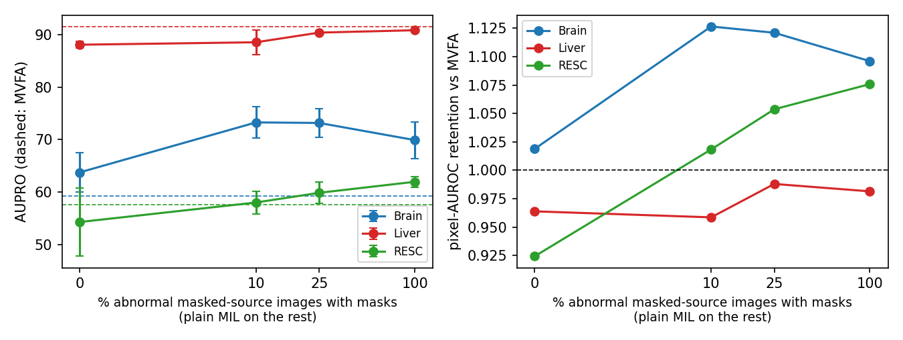
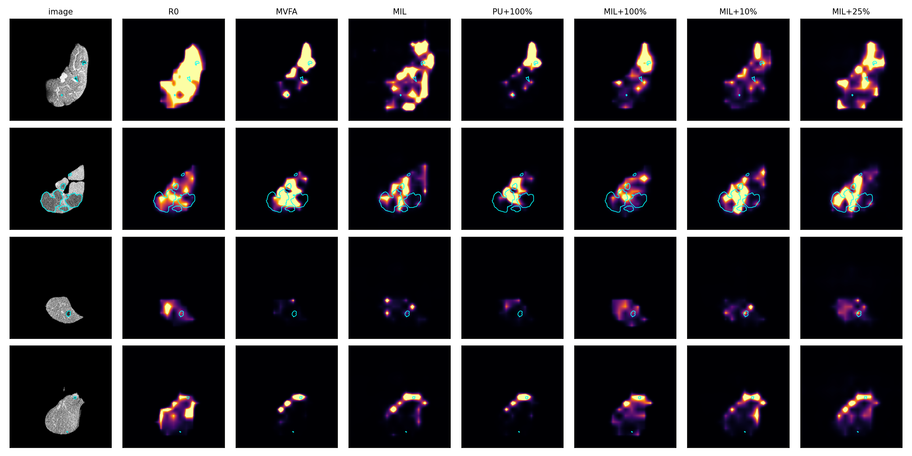

# Task 4, round 3 (final): the positives at 20 epochs on fresh seeds, then combined

**Summary.** Round 3 re-ran the arms behind rounds 1–2's four positive results, at **20 epochs** (4× round 2) on **fresh seeds 3–5**. It also ran three new arms that combine those results: plain MIL added to MVFA's mask training (**MIL+100 %**), and plain MIL with masks for only **10 %** or **25 %** of the abnormal images. All 58 planned runs finished, with no failures. The rules were frozen before any GPU run (`RULES.md`, `analyze3.py`; hashes in ISSUES_LOG R3-9) and applied unchanged. Under them:

- **H1 holds, and more strongly than before.** Plain top-k MIL, trained without any mask, keeps **0.969** of MVFA's pixel AUROC on average. On every target it keeps at least 0.92: Brain 1.019, Liver 0.964, RESC 0.924. That earns the rule's top grade, "nearly matches". Round 2 measured 0.930.
- **H2 did not replicate.** MIL beat MVFA on Brain AUPRO on only 3 of 5 seeds (p = 0.50), and its mean Brain pixel AUROC is 0.8 lower. Round 2's 3/3 Brain win does not survive the longer schedule.
- **H3 did not replicate.** PU+100 % has a higher AUPRO than MVFA in 5 of 9 pairs (p = 0.50), against round 2's "suggestive" 7/9.
- **H4: MIL+100 % matches MVFA but does not beat it.** AUPRO is higher in 6 of 9 pairs (Holm p = 0.51). The mean pixel Δ is +3.6 on Brain, −0.9 on Liver and +2.7 on RESC, within the rule's −1 on every target.
- **H5 trails.** MIL+10 % misses "matches" on Liver: its pixel Δ is −1.96, against a limit of −1. On Brain it is +4.8 pixel AUROC and +14.0 AUPRO.

The longer schedule settles round 2's main caveat. Only **11 of 58** runs picked their last epoch, against 37 of 57 in round 2. But training longer did not help MVFA on the targets' *image* AUROC: it fell on every target (Brain 65.7 → 56.3). Model selection on source validation does not protect target image-level detection (§5).

Numbers: [`results/results.csv`](../results/results.csv) (76 rows, 58 runs), [`results/analysis.md`](../results/analysis.md) (the frozen rules applied by `analyze3.py`), [`results/per_seed.md`](../results/per_seed.md). Verdict: [`VERDICT.md`](VERDICT.md). Paper claims: [`PAPER_CLAIMS.md`](PAPER_CLAIMS.md). Paper tables and figures: [`paper_inputs/task4_r3/`](paper_inputs/task4_r3/).

---

## 1. Idea and arms

**Problem A1 (Task 3).** MVFA's segmentation adapters learn only from pixel masks. Can they learn from image labels, and how much localisation survives on an unseen modality?

**Method: plain top-k MIL.** At each adapter level l, an image's score is the mean of its k = 3 most anomalous patch probabilities (of 289), trained with BCE against the image label: L = Σ_l w_l · BCE(mean_{TopK} p_l, y).

| Arm | What it is | Tier, purpose |
|---|---|---|
| **MVFA** | Mask-supervised MVFA, re-run from scratch under the same rule (round 2's `mvfa`) | Baseline for every comparison |
| **MIL** | Plain MIL; every mask discarded (round 2's `mil`) | Tier 1: P1 (H1) and P2 (H2) |
| **PU+100 %** | MVFA's masks, plus nnPU (π = 1 %) on the mask-less sources (round 2's `pu_m100`) | Tier 1: P3 (H3) |
| **MIL+100 %** | MVFA's masks on the masked sources, plus MIL on the mask-less sources (OCT17, Chest, HIS) (new `mil_m100`) | Tier 2: H4 |
| **MIL+10 %, MIL+25 %** | Masks kept for a seeded 10 % / 25 % of the masked sources' abnormal images (100 / 250 of 1,000 per fold, same count for every seed); MIL on every other image (new `mil_m10`, `mil_m25`) | Tier 2: H5 and the budget curve |

**Everything else is round 2's:**
- the code, apart from the three arm names and nested budget sets (R3-2);
- the protocol: leave-one-modality-out, RESC and OCT17 held out together, a source-validation checkpoint chosen after every epoch;
- the subsample: at most 1,000 images per source;
- batch 1, k = 3, π = 1 %;
- the guardrails: only `evaluate_target.py` reads test sets, and results are append-only.

Folds: Brain, Liver and RESC+OCT17 (the last also scored on OCT17). Seeds 3–5, plus Brain seeds 6–7 for MVFA and MIL, so H2 has 5 seeds.

## 2. Issues log with feedback

Full log: [`ISSUES_LOG.md`](ISSUES_LOG.md). It has 11 setup items (G1), the GPU checks (G1b), the run (G2) and the result checks (G3). The teammate's words are quoted verbatim:
- **Session A:** *"prepare for this, so that whenever we get the GPUs free, we can directly run"*.
- **GPU booking:** *"no need we book and use GPUs so no one uses while other person is using…"*.
- **Timing check:** *"gpu util is too low at times"*, *"nvm, it's just increasing and decreasing"*, *"yeah restart it with all 58 if it's not slower"*.

| # | Issue | Effect |
|---|---|---|
| R3-2 | Round 2's budget sets were not nested (the 10 % set shared only 9 of 37 images with the 25 % set); the plan's test requires 25 % ⊃ 10 % | One line changed: the sets are prefixes of one seeded permutation. The budget curve is a real curve |
| R3-3 | Both GPUs were in use by other users at setup time | `go.sh` waits for free GPUs, then runs the smoke test, timing check, runs and analysis unattended |
| R3-4 | "4× round 2" can be measured in several ways that disagree | Fixed before any run: round-2-equivalent run-epochs = run-epochs × measured slowdown; cap 1,400 |
| R3-10 | The CPU smoke test crashed because torch opened a CUDA context on full GPUs | GPUs hidden for the CPU smoke test; all 7 jobs passed |
| **R3-11** | The timing check measured a 1.73× slowdown and cut 13 runs. That number compared a 15-second startup window, with 12 jobs starting together, against round 2's whole epochs | Re-measured on the first full epochs of the real runs: **1.11×**, so 1,288 < 1,400 and **no cut**. The 45-run queue was stopped after 1–2 epochs, before any result was written, and all 58 runs were relaunched on the teammate's instruction |
| G3-1 | `analysis.md`'s pooled in-mask figure counts each RESC+OCT17 run twice, and Brain seeds 6–7 once each | Descriptive only (no rule uses it). The frozen file is unchanged; the report cites per-fold values (§3.6) |
| G3-2 | `PAPER_PLAN.md` (named in plan §4 B4 and §6) was not supplied | `paper_inputs/task4_r3/` follows round 1's `paper_inputs/` layout; the §5.2 framing is left to the teammate |

## 3. Results

Points = AUROC/AUPRO × 100. Mean ± std over seeds 3–5. Every run is listed in the appendix.

### 3.1 Main table (masked targets)

| Target | Metric | MVFA re-run | MIL (0 %) | PU+100 % | MIL+100 % | MIL+10 % | MIL+25 % |
|---|---|---|---|---|---|---|---|
| Brain | pix | 87.84 ± 0.87 | 88.56 ± 2.77 | 89.82 ± 0.61 | 91.48 ± 0.98 | **92.63 ± 0.76** | 92.42 ± 0.80 |
| Brain | AUPRO | 59.31 ± 2.15 | 63.77 ± 3.77 | 65.75 ± 1.72 | 69.91 ± 3.48 | **73.29 ± 2.99** | 73.18 ± 2.72 |
| Brain | img | 56.33 ± 6.73 | 67.50 ± 3.70 | **67.52 ± 8.31** | 60.30 ± 0.65 | 61.21 ± 6.40 | 58.62 ± 7.55 |
| Liver | pix | **97.21 ± 0.01** | 95.50 ± 0.12 | 96.57 ± 0.20 | 96.33 ± 0.29 | 95.25 ± 1.61 | 96.64 ± 0.22 |
| Liver | AUPRO | **91.55 ± 0.09** | 88.08 ± 0.68 | 91.04 ± 0.28 | 90.84 ± 0.01 | 88.55 ± 2.32 | 90.39 ± 0.36 |
| Liver | img | 60.60 ± 2.53 | 67.95 ± 4.11 | 63.86 ± 4.01 | 63.42 ± 3.21 | 65.64 ± 6.50 | **68.05 ± 6.12** |
| RESC | pix | 86.14 ± 0.69 | 83.40 ± 3.71 | 87.26 ± 0.98 | **88.88 ± 0.41** | 86.80 ± 1.05 | 88.08 ± 0.89 |
| RESC | AUPRO | 57.66 ± 1.39 | 54.31 ± 6.52 | 57.78 ± 2.89 | **61.97 ± 1.04** | 58.03 ± 2.16 | 59.88 ± 2.04 |
| RESC | img | **74.29 ± 2.95** | 71.27 ± 0.83 | 71.37 ± 1.45 | 72.25 ± 2.66 | 71.58 ± 2.03 | 72.71 ± 1.50 |

Bold marks the highest mean in each row. It is not a test.

### 3.2 OCT17 (image AUROC only; scored by the RESC+OCT17 fold's model)

| MVFA | MIL | PU+100 % | MIL+100 % | MIL+10 % | MIL+25 % |
|---|---|---|---|---|---|
| **70.75 ± 11.09** | 62.13 ± 3.99 | 65.09 ± 2.37 | 61.84 ± 3.62 | 59.27 ± 3.74 | 64.63 ± 2.90 |

MVFA's OCT17 mean rests on one high-variance arm (79.5 / 74.4 / 58.3 across seeds). Every arm that adds an image-label loss on the mask-less sources scores lower on OCT17. Round 2 saw the same for G+100 %.

### 3.3 Rules applied (frozen before any run; `RULES.md`)

| # | Rule | Numbers | Outcome |
|---|---|---|---|
| **H1** | Retention (pix − 50)/(MVFA − 50) ≥ 0.90 on all 3 targets → "nearly matches"; mean ≥ 0.75 → "keeps most" | Brain 1.019, Liver 0.964, RESC 0.924; mean 0.969 | **NEARLY MATCHES** |
| **H2** | Brain AUPRO higher on 5/5 seeds and mean Brain pix higher (Holm with H3) | 3/5 seeds (s3 −0.40, s4 +2.85, s5 +10.93, s6 −6.95, s7 +6.77); pix Δ −0.81; p = 0.50, Holm 1.00 | **did not replicate** |
| **H3** | AUPRO higher in ≥ 8/9 pairs (Holm p ≤ 0.05), pix higher on ≥ 2/3 targets, img ≥ −0.5 on every target | 5/9; pix Δ +1.97 / −0.64 / +1.12; img Δ RESC −2.92; p = 0.50, Holm 1.00 | **did not replicate** |
| **H4** | H3's rule (Holm with H5); otherwise "matches" if pix Δ ≥ −1 on every target | 6/9; pix Δ +3.63 / **−0.88** / +2.74; img Δ RESC −2.04; p = 0.25, Holm 0.51 | **MATCHES** (not beats) |
| **H5** | Pix Δ ≥ −1 on every target → "matches"; also H3's rule → "beats" | pix Δ +4.79 / **−1.96** / +0.66; 4/9; p = 0.75 | **TRAILS** |

Paired AUPRO Δ against MVFA, same seed (Brain s3 s4 s5 | Liver | RESC):
- **PU+100 %:** +4.22 +4.21 +10.91 | −0.68 −0.63 −0.23 | +2.43 −4.83 +2.74.
- **MIL+100 %:** +7.92 +6.85 +17.04 | −0.61 −0.79 −0.74 | +5.72 +1.51 +5.70.
- **MIL+10 %:** +10.89 +16.31 +14.74 | −1.75 −1.57 −5.70 | +3.67 −2.35 −0.21.

The same pattern runs through all three arms. **Brain gains, Liver loses, and RESC is mixed or gains.** MIL+100 % is ahead of MVFA on **6 of 6** Brain and RESC pairs, and behind on 3 of 3 Liver pairs by less than one AUPRO point. That is a post-hoc observation, not a pre-registered test, and is reported only as such.

### 3.4 Label-budget curve (descriptive, no test)

| Masks | Arm | Retention Brain / Liver / RESC (mean) | AUPRO Brain | AUPRO Liver | AUPRO RESC |
|---|---|---|---|---|---|
| 0 % | MIL | 1.019 / 0.964 / 0.924 (0.969) | 63.77 ± 3.77 | 88.08 ± 0.68 | 54.31 ± 6.52 |
| 10 % | MIL+10 % | 1.126 / 0.959 / 1.018 (1.034) | 73.29 ± 2.99 | 88.55 ± 2.32 | 58.03 ± 2.16 |
| 25 % | MIL+25 % | 1.121 / 0.988 / 1.054 (1.054) | 73.18 ± 2.72 | 90.39 ± 0.36 | 59.88 ± 2.04 |
| 100 % + MIL | MIL+100 % | 1.096 / 0.981 / 1.076 (1.051) | 69.91 ± 3.48 | 90.84 ± 0.01 | 61.97 ± 1.04 |
| 100 % | MVFA | 1.000 | 59.31 ± 2.15 | 91.55 ± 0.09 | 57.66 ± 1.39 |

- **Mean retention rises from 0.969 to 1.034 with 10 % of the masks and then levels off:** 1.054 at 25 %, 1.051 at 100 % + MIL.
- **Brain gains the most from a small budget.** With 100 masks it reaches AUPRO 73.3 ± 3.0, against MVFA's 59.3 ± 2.2. Each budget seed is above every MVFA seed (71.6 / 76.7 / 71.6 vs 60.7 / 60.4 / 56.8).
- **Liver is the one target where masks keep mattering.** AUPRO goes 88.1 → 88.6 → 90.4 → 90.8, and every point stays below MVFA's 91.6. The 10 % arm is also the least stable on Liver (88.55 ± 2.32; seed 5 is 85.87 AUPRO and 93.41 pixel AUROC, per_seed.md).
- **On RESC, 10 % of the masks bring MIL level with MVFA** (58.0 vs 57.7 AUPRO), and 25 % and 100 % + MIL go past it.
- **Round 2's gated-MIL budget curve did not test this.** That curve (1 seed) showed G+10 % closing 62 % of G's Liver gap. With plain MIL at 0 % already at 88.1, the 10 % budget adds little on Liver (+0.5 AUPRO) but a lot on Brain (+9.5) and RESC (+3.7).

### 3.5 Round 3 (20 epochs, seeds 3–5) vs round 2 (5 epochs, seeds 0–2), never pooled

| Arm | Target | R2 → R3 pix | R2 → R3 AUPRO | R2 → R3 img |
|---|---|---|---|---|
| MVFA | Brain | 88.32 → 87.84 | 61.55 → 59.31 | 65.73 → **56.33** |
| MVFA | Liver | 96.80 → 97.21 | 90.40 → 91.55 | 71.16 → **60.60** |
| MVFA | RESC | 87.92 → 86.14 | 58.93 → 57.66 | 79.98 → 74.29 |
| MIL | Brain | 91.71 → 88.56 | **70.63 → 63.77** | 66.93 → 67.50 |
| MIL | Liver | 96.19 → 95.50 | 89.26 → 88.08 | 69.90 → 67.95 |
| MIL | RESC | 77.14 → 83.40 | 48.80 → 54.31 | 76.47 → 71.27 |
| PU+100 % | Brain | 88.77 → 89.82 | 63.32 → 65.75 | 70.51 → 67.52 |
| PU+100 % | Liver | 96.91 → 96.57 | 91.19 → 91.04 | 73.83 → 63.86 |
| PU+100 % | RESC | 88.60 → 87.26 | 60.38 → 57.78 | 77.49 → 71.37 |

The seeds differ between rounds, so each row mixes the effect of the schedule with seed variation.

- **Localisation (pixel AUROC, AUPRO) barely moves with 4× the training,** apart from two changes. MIL on RESC becomes much more stable (pix std 9.9 → 3.7; the worst seed 67.4 → 79.1). MIL's Brain advantage shrinks (AUPRO 70.6 → 63.8).
- **Target image AUROC falls for every mask-trained arm.** The fall is largest for MVFA: Brain −9.4, Liver −10.6, RESC −5.7. Source validation keeps rising (mean final 0.965), so longer training fits the source datasets better while the targets' image-level separation gets worse. MIL's image AUROC changes least.
- **H2 failed because of the schedule and the seeds, not because the arm changed.** MIL's per-seed Brain AUPRO spans 52.6 to 67.8 over 5 seeds; that spread is wider than the whole MIL−MVFA gap of round 2.

### 3.6 Diagnostics

**Best epoch** (0-based; selected on source validation): only 11 of 58 runs picked the last epoch (round 2: 37/57), and 18 picked one of the last two. Source-validation AUROC gains only 0.011 between epochs 5 and 20. By the plan's criterion the runs are **no longer under-trained**. The schedule is still shorter than MVFA's 50 epochs.

**In-mask diagnostic** (round 2's): the share of the top-3 patches that fall inside the true mask, on the fold's masked sources' `valid/` abnormal images, at the selected checkpoint (seeds 3–5, each run once).

| Arm | Brain fold | Liver fold | RESC+OCT17 fold | Mean |
|---|---|---|---|---|
| MVFA | 0.929 | 0.843 | 0.590 | 0.787 |
| PU+100 % | 0.929 | 0.837 | 0.598 | 0.788 |
| MIL+100 % | 0.919 | 0.829 | 0.589 | 0.779 |
| MIL+25 % | 0.865 | 0.788 | 0.481 | 0.711 |
| MIL+10 % | 0.820 | 0.759 | 0.404 | 0.661 |
| MIL | 0.546 | 0.647 | 0.163 | 0.452 |

The in-mask share rises steadily with the share of masked images: 0 % → 10 % → 25 % → 100 % gives 0.45 → 0.66 → 0.71 → 0.78. The image-label loss on mask-less sources (PU, MIL) does not change it at full masks. This repeats round 2's finding: mask supervision decides where the top-k lands. `analysis.md` gives slightly lower pooled values (0.766 / 0.417 / …), because its descriptive average counts each RESC+OCT17 run twice (G3-1).

**Image AUROC below 50:** none. The lowest is MVFA Brain at 51.8 (seed 3).

**Heat maps** (Liver, seed 3; round 1's 4 images and fixed rules; R0 = the released checkpoint, reference only): [`liver_heatmaps_r3.png`](liver_heatmaps_r3.png).

- MVFA, PU+100 % and MIL+100 % give compact maps that sit on the larger lesions.
- MIL without masks also lights up the liver outline and other bright structures (rows 1 and 4).
- MIL+10 % and MIL+25 % fall in between, with more spread than MVFA.
- On the small lesion in row 3, MIL+10 % and MIL+25 % put a hot spot on it, while MVFA's map is nearly blank there.

These are 4 images from 1 seed, chosen by a fixed rule before any map was seen. They illustrate the pattern; they are not evidence.

## 4. Rules applied, and an honest reading

- **Every run is reported.** The plan had 58 runs; all 58 have results, none was cut and none failed (appendix). The 12 runs from the stopped 45-run queue (R3-11) had written no results; their folders are archived and none of their numbers is used.
- **Every rule was applied as frozen.** `go.sh` checked the hashes of `RULES.md` and `analyze3.py` before launch, and they still match after the analysis. Under those rules two of round 2's three tested positives (P2, P3) **do not replicate** at 20 epochs on fresh seeds. They were the two that were not pre-registered or only "suggestive".
- **No target selection:** each run's `run.json` lists exactly one test set read (two for RESC+OCT17), all through `evaluate_target.py` after checkpoint selection.
- **What holds:**
  - Image-label MIL with no masks localises almost as well as mask-supervised MVFA: retention ≥ 0.92 on every target, now over three rounds and two schedules.
  - Adding MIL on the mask-less sources to MVFA's mask training gives a model that matches MVFA. It is ahead of MVFA on Brain and RESC and within one point on Liver.
- **What does not hold:**
  - "MIL beats MVFA on Brain" (3/5 seeds);
  - "PU+100 % beats MVFA" (5/9);
  - "10 % of masks match MVFA" (Liver −1.96).
- **Post-hoc observations, worth a follow-up but not claims:**
  - On Brain, a 10 % mask budget beats MVFA on every seed by 11–16 AUPRO points.
  - MIL+100 % is ahead on all 6 Brain and RESC pairs.
  Neither was the pre-registered test. With 3 seeds and several arms, a large single-target effect is exactly what the rules were written not to reward.

## 5. Limitations

1. **Schedule and subsample.** 20 epochs (MVFA uses 50) on at most 1,000 images per source per dataset. The runs are no longer stuck at the last epoch (11/58), but the released checkpoint (R0) is still far ahead on image AUROC (Brain 79.8 vs 56.3).
2. **Source-validation selection does not track the target.** Source validation saturates at 0.96–0.97. Target image AUROC fell with longer training for every mask-trained arm (§3.5): MVFA's Brain image AUROC is 51.8–64.1 across 5 seeds, close to chance. This is Task 3's protocol, used as specified; it is not a tuning choice.
3. **Three seeds.** Brain has 5 seeds, for H2 only. Per-seed spreads are large on Brain (MIL AUPRO 52.6–67.8) and RESC. One-sided sign tests on 9 pairs can only confirm at 8/9 or better.
4. **One schedule per round.** The round 2 vs round 3 comparison mixes the epoch count with the seed set, so it is never pooled and never tested.
5. **Targets.** Only the three masked folds were rerun. Chest and HIS rely on round 2 (where Chest was below chance for every arm). RESC and OCT17 are held out together, so their numbers are not comparable with MVFA's paper or round 1.
6. **Single codebase and fixed hyper-parameters:** one MVFA implementation, k = 3, π = 1 %, batch 1. There is no sweep, and the budget sets are one seeded draw per seed.
7. **Heat maps** are 4 images from 1 seed: an illustration only.
8. **The paper plan (`PAPER_PLAN.md`) was not available** to this session. `paper_inputs/` follows round 1's layout, and the §5.2 framing is left to the teammate (G3-2).

## 6. Compute and reproducibility

- **Wall-clock (2 × RTX PRO 6000 Blackwell, booked):**
  - tests and GPU wait: 10:54–10:56;
  - smoke test: 21 s;
  - timing check: 38 s;
  - the stopped 45-run queue: 10:57–11:06;
  - the 58 runs: **11:06:36–16:44:31 (5 h 38 min)**, 12 concurrent jobs;
  - `analyze3.py`: 2 s.
- **Compute:**
  - 3,787 job-minutes for the 58 runs, which is 3.5× round 2's 1,077 and within the plan's 3.5× budget;
  - 1,160 run-epochs at a measured 1.11× round 2's per-step cost, so 1,288 round-2-equivalent run-epochs, under the 1,400 cap;
  - the stopped queue used about 110 extra job-minutes.
- **Reproducibility:**
  - code: `task4r3/`; round 2's code plus 3 arm names and the nested budget sets;
  - configs: `run_all.sh r3`;
  - seeds: 3–7, setting initialisation, data order and the budget sets;
  - checks: 80 tests (41 + 39) and a CPU and GPU smoke test;
  - rules: frozen hashes in `report/FROZEN.sha256`;
  - results: `results/results.csv`;
  - paper tables: rebuilt by `make_paper_inputs3.py`;
  - figures: `make_figures.py`;
  - per-run adapters, loss curves, `run.json` files and Liver maps: `/mnt/HDD1/divyam/task4/r3/runs/` (3.5 GB, not in git).
- **AI's role:** Claude Code (Opus 5.5) wrote round 3's code changes, tests, rules and launcher, monitored the GPU run and wrote this report. The teammate booked the GPUs, started the run, approved the restart, and is quoted verbatim in the issues log. The transcript is in `report/transcript/`.

---

## Appendix: every run

One line per (run, evaluated dataset), read from `results/results.csv`. Points ×100; best epoch is 0-based (19 = last). The RESC+OCT17 runs have two lines (RESC, then OCT17 image AUROC). Job minutes include validation, the diagnostic and the target evaluation.

| # | run | evaluated on | img AUROC | pix AUROC | AUPRO | best epoch | in-mask p | job min |
|---|---|---|---|---|---|---|---|---|
| 1 | `mvfa_Brain_s3` | Brain | 51.83 | 88.58 | 60.67 | 14 | 0.927 | 70.8 |
| 2 | `mvfa_Brain_s4` | Brain | 53.10 | 88.05 | 60.43 | 14 | 0.928 | 70.4 |
| 3 | `mvfa_Brain_s5` | Brain | 64.06 | 86.89 | 56.82 | 16 | 0.933 | 70.8 |
| 4 | `mvfa_Brain_s6` | Brain | 55.28 | 87.82 | 59.57 | 14 | 0.931 | 64.2 |
| 5 | `mvfa_Brain_s7` | Brain | 53.07 | 88.06 | 60.27 | 15 | 0.931 | 63.9 |
| 6 | `mvfa_Liver_s3` | Liver | 57.68 | 97.22 | 91.46 | 19 | 0.845 | 69.8 |
| 7 | `mvfa_Liver_s4` | Liver | 61.85 | 97.20 | 91.63 | 17 | 0.846 | 69.8 |
| 8 | `mvfa_Liver_s5` | Liver | 62.25 | 97.21 | 91.57 | 18 | 0.838 | 68.8 |
| 9 | `mvfa_RESC_OCT_s3` | Retina_RESC | 72.11 | 85.58 | 56.85 | 19 | 0.588 | 59.3 |
|  | `mvfa_RESC_OCT_s3` | Retina_OCT2017 | 79.53 | – | – | 19 | 0.588 | 59.4 |
| 10 | `mvfa_RESC_OCT_s4` | Retina_RESC | 73.11 | 86.91 | 59.27 | 18 | 0.597 | 59.3 |
|  | `mvfa_RESC_OCT_s4` | Retina_OCT2017 | 74.43 | – | – | 18 | 0.597 | 59.4 |
| 11 | `mvfa_RESC_OCT_s5` | Retina_RESC | 77.65 | 85.93 | 56.87 | 14 | 0.585 | 59.3 |
|  | `mvfa_RESC_OCT_s5` | Retina_OCT2017 | 58.30 | – | – | 14 | 0.585 | 59.4 |
| 12 | `mil_Brain_s3` | Brain | 66.53 | 88.59 | 60.27 | 12 | 0.493 | 71.9 |
| 13 | `mil_Brain_s4` | Brain | 71.59 | 85.78 | 63.28 | 19 | 0.496 | 71.9 |
| 14 | `mil_Brain_s5` | Brain | 64.39 | 91.31 | 67.75 | 18 | 0.651 | 71.9 |
| 15 | `mil_Brain_s6` | Brain | 61.66 | 83.64 | 52.61 | 13 | 0.589 | 70.6 |
| 16 | `mil_Brain_s7` | Brain | 63.27 | 86.05 | 67.04 | 17 | 0.699 | 70.7 |
| 17 | `mil_Liver_s3` | Liver | 69.47 | 95.54 | 87.44 | 14 | 0.556 | 73.2 |
| 18 | `mil_Liver_s4` | Liver | 63.30 | 95.37 | 88.03 | 17 | 0.699 | 73.1 |
| 19 | `mil_Liver_s5` | Liver | 71.09 | 95.60 | 88.78 | 10 | 0.687 | 73.2 |
| 20 | `mil_RESC_OCT_s3` | Retina_RESC | 70.93 | 85.31 | 53.94 | 18 | 0.164 | 62.7 |
|  | `mil_RESC_OCT_s3` | Retina_OCT2017 | 61.83 | – | – | 18 | 0.164 | 62.7 |
| 21 | `mil_RESC_OCT_s4` | Retina_RESC | 70.67 | 79.13 | 47.99 | 18 | 0.153 | 62.4 |
|  | `mil_RESC_OCT_s4` | Retina_OCT2017 | 66.26 | – | – | 18 | 0.153 | 62.5 |
| 22 | `mil_RESC_OCT_s5` | Retina_RESC | 72.22 | 85.78 | 61.00 | 15 | 0.171 | 62.5 |
|  | `mil_RESC_OCT_s5` | Retina_OCT2017 | 58.29 | – | – | 15 | 0.171 | 62.5 |
| 23 | `pu_m100_Brain_s3` | Brain | 73.48 | 89.68 | 64.89 | 16 | 0.930 | 60.5 |
| 24 | `pu_m100_Brain_s4` | Brain | 58.03 | 89.29 | 64.64 | 10 | 0.926 | 60.3 |
| 25 | `pu_m100_Brain_s5` | Brain | 71.05 | 90.48 | 67.73 | 12 | 0.930 | 60.3 |
| 26 | `pu_m100_Liver_s3` | Liver | 61.73 | 96.36 | 90.78 | 13 | 0.838 | 58.8 |
| 27 | `pu_m100_Liver_s4` | Liver | 61.36 | 96.60 | 91.00 | 15 | 0.835 | 58.7 |
| 28 | `pu_m100_Liver_s5` | Liver | 68.48 | 96.76 | 91.34 | 16 | 0.839 | 58.7 |
| 29 | `pu_m100_RESC_OCT_s3` | Retina_RESC | 70.53 | 87.85 | 59.28 | 19 | 0.610 | 49.2 |
|  | `pu_m100_RESC_OCT_s3` | Retina_OCT2017 | 66.82 | – | – | 19 | 0.610 | 49.3 |
| 30 | `pu_m100_RESC_OCT_s4` | Retina_RESC | 73.05 | 86.13 | 54.44 | 14 | 0.593 | 49.3 |
|  | `pu_m100_RESC_OCT_s4` | Retina_OCT2017 | 66.06 | – | – | 14 | 0.593 | 49.3 |
| 31 | `pu_m100_RESC_OCT_s5` | Retina_RESC | 70.53 | 87.80 | 59.62 | 19 | 0.593 | 49.2 |
|  | `pu_m100_RESC_OCT_s5` | Retina_OCT2017 | 62.38 | – | – | 19 | 0.593 | 49.2 |
| 32 | `mil_m100_Brain_s3` | Brain | 60.95 | 91.07 | 68.59 | 19 | 0.923 | 80.4 |
| 33 | `mil_m100_Brain_s4` | Brain | 59.64 | 90.77 | 67.29 | 13 | 0.918 | 80.4 |
| 34 | `mil_m100_Brain_s5` | Brain | 60.30 | 92.59 | 73.87 | 8 | 0.916 | 77.3 |
| 35 | `mil_m100_Liver_s3` | Liver | 59.82 | 96.00 | 90.85 | 13 | 0.833 | 76.6 |
| 36 | `mil_m100_Liver_s4` | Liver | 65.98 | 96.51 | 90.84 | 17 | 0.828 | 76.5 |
| 37 | `mil_m100_Liver_s5` | Liver | 64.48 | 96.50 | 90.83 | 19 | 0.827 | 74.8 |
| 38 | `mil_m100_RESC_OCT_s3` | Retina_RESC | 74.83 | 89.33 | 62.58 | 14 | 0.590 | 64.6 |
|  | `mil_m100_RESC_OCT_s3` | Retina_OCT2017 | 57.67 | – | – | 14 | 0.590 | 64.7 |
| 39 | `mil_m100_RESC_OCT_s4` | Retina_RESC | 72.38 | 88.52 | 60.78 | 18 | 0.594 | 64.6 |
|  | `mil_m100_RESC_OCT_s4` | Retina_OCT2017 | 64.20 | – | – | 18 | 0.594 | 64.7 |
| 40 | `mil_m100_RESC_OCT_s5` | Retina_RESC | 69.53 | 88.79 | 62.57 | 17 | 0.583 | 68.2 |
|  | `mil_m100_RESC_OCT_s5` | Retina_OCT2017 | 63.65 | – | – | 17 | 0.583 | 68.3 |
| 41 | `mil_m10_Brain_s3` | Brain | 66.70 | 92.05 | 71.56 | 18 | 0.840 | 69.9 |
| 42 | `mil_m10_Brain_s4` | Brain | 54.18 | 93.49 | 76.74 | 19 | 0.819 | 70.0 |
| 43 | `mil_m10_Brain_s5` | Brain | 62.74 | 92.35 | 71.56 | 13 | 0.800 | 70.3 |
| 44 | `mil_m10_Liver_s3` | Liver | 61.56 | 96.35 | 89.71 | 19 | 0.783 | 68.9 |
| 45 | `mil_m10_Liver_s4` | Liver | 62.22 | 96.01 | 90.06 | 14 | 0.760 | 68.8 |
| 46 | `mil_m10_Liver_s5` | Liver | 73.14 | 93.41 | 85.87 | 10 | 0.735 | 68.6 |
| 47 | `mil_m10_RESC_OCT_s3` | Retina_RESC | 71.57 | 87.92 | 60.52 | 16 | 0.415 | 59.5 |
|  | `mil_m10_RESC_OCT_s3` | Retina_OCT2017 | 62.94 | – | – | 16 | 0.415 | 59.5 |
| 48 | `mil_m10_RESC_OCT_s4` | Retina_RESC | 73.62 | 85.84 | 56.92 | 11 | 0.394 | 59.5 |
|  | `mil_m10_RESC_OCT_s4` | Retina_OCT2017 | 59.39 | – | – | 11 | 0.394 | 59.6 |
| 49 | `mil_m10_RESC_OCT_s5` | Retina_RESC | 69.55 | 86.64 | 56.66 | 15 | 0.404 | 51.8 |
|  | `mil_m10_RESC_OCT_s5` | Retina_OCT2017 | 55.47 | – | – | 15 | 0.404 | 51.9 |
| 50 | `mil_m25_Brain_s3` | Brain | 57.43 | 91.51 | 70.04 | 16 | 0.876 | 58.6 |
| 51 | `mil_m25_Brain_s4` | Brain | 66.70 | 92.73 | 74.63 | 13 | 0.839 | 53.5 |
| 52 | `mil_m25_Brain_s5` | Brain | 51.73 | 93.03 | 74.87 | 16 | 0.880 | 71.0 |
| 53 | `mil_m25_Liver_s3` | Liver | 65.34 | 96.85 | 90.17 | 8 | 0.764 | 69.9 |
| 54 | `mil_m25_Liver_s4` | Liver | 63.75 | 96.42 | 90.21 | 19 | 0.800 | 65.7 |
| 55 | `mil_m25_Liver_s5` | Liver | 75.06 | 96.66 | 90.80 | 13 | 0.798 | 65.3 |
| 56 | `mil_m25_RESC_OCT_s3` | Retina_RESC | 73.99 | 88.61 | 61.04 | 14 | 0.498 | 60.4 |
|  | `mil_m25_RESC_OCT_s3` | Retina_OCT2017 | 61.37 | – | – | 14 | 0.498 | 60.5 |
| 57 | `mil_m25_RESC_OCT_s4` | Retina_RESC | 71.06 | 87.05 | 57.52 | 15 | 0.483 | 60.5 |
|  | `mil_m25_RESC_OCT_s4` | Retina_OCT2017 | 65.61 | – | – | 15 | 0.483 | 60.5 |
| 58 | `mil_m25_RESC_OCT_s5` | Retina_RESC | 73.08 | 88.58 | 61.07 | 19 | 0.461 | 35.3 |
|  | `mil_m25_RESC_OCT_s5` | Retina_OCT2017 | 66.91 | – | – | 19 | 0.461 | 35.4 |
